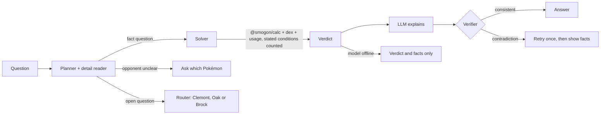
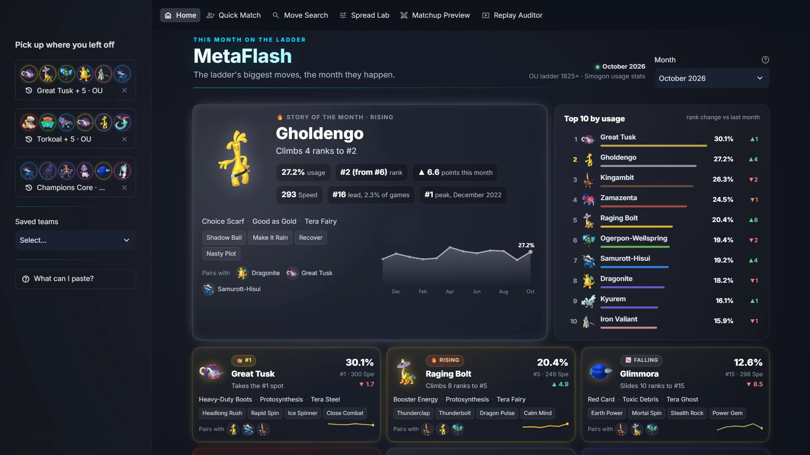
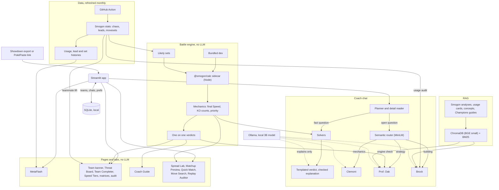

<p align="center">
  
</p>

<h1 align="center">MetaMatch</h1>

[](https://www.python.org/)
[](https://opensource.org/licenses/MIT)

Built with [Streamlit](https://streamlit.io/), [Ollama](https://ollama.com/), the [Smogon damage calc](https://github.com/smogon/damage-calc) and [ChromaDB](https://www.trychroma.com/).

**[Take the visual tour](showcase/)**, every screen of the app with real data and real coach answers.

**MetaMatch** is a hybrid AI system for competitive Pokémon team analysis that runs entirely on a laptop. It pairs a deterministic battle engine (the official Smogon damage calculator, monthly ladder statistics, type and role logic) with a small local LLM, on one principle:

> ### 🧠 The engine does the thinking. The LLM does the talking.

Every factual answer (damage rolls, KOs, speed, immunities, stats, usage) is computed by code before the model ever sees the question. The LLM only explains a verdict that is already correct, and a verifier throws out any explanation that contradicts it.

Paste your team, and MetaMatch tells you what beats it, what it beats, how to lead, when to Tera and what to change, then lets you ask three coaches anything about it in plain words. *(Curious how well that holds up? The numbers are in [bench/README.md](bench/README.md).)*

* ⚡ **Instant:** a full team analysis lands in about a second, with no GPU needed for anything but chat.
* 🔌 **Works offline:** every analysis tab runs on the engine alone. The LLM is an upgrade, not a dependency.
* 🔒 **Private:** your teams never leave your machine. No API keys, no cloud, no paid models.
* 📡 **Always current:** MetaFlash turns every month of Smogon ladder data since Gen 9 began into a live meta front page, refreshed every month by CI.
* 🔗 **Every team has a link:** dashboards live at their own URL, so refresh, bookmarks, Back and a second tab all just work.


---

## ⚙️ How a Chat Answer Is Made



1. **Planner (zero LLM):** works out what the question asks (speed, KO, damage, type, stat or usage) and which Pokémon, move and set are involved. Recognizes all 1,400+ species and formes in the bundled dex, plus nicknames (*Lando*, *Pult*, *Tusk*), regional shorthand (*G Slowking*), typos and Mega names.
2. **Detail reader (zero LLM):** picks up everything the question says about either side, like *"max speed"*, *"specs"*, *"tera fairy"*, *"+2 after a Dragon Dance"*, Reflect, rain or a pasted set, and knows which Pokémon it belongs to. Mirror matches (*"tusk mirror, theirs is Jolly"*) work too. It also reads battle conditions: Tailwind, Trick Room, a burn or paralysis, an HP percentage, Stealth Rock, Spikes or a critical hit. Each one is counted when it changes the answer, and the answer says so (*"Counted from the question: Tailwind on your side"*). Anything it can't model, like Sticky Web or Helping Hand, is named as not counted instead of being dropped.
3. **Solver:** computes the answer with the real damage calculator, using what you said and the most common ladder set for everything else, and tells you which is which.
4. **Verdict:** the headline answer comes from a template, so it is always the engine's answer, never the model's guess.
5. **Verifier:** the LLM writes a short explanation, read clause by clause, so *"Dragapult can't outspeed Tusk"* counts as agreeing with *"yes, Tusk is faster"*. Any number not in the facts, or any claim that flips the speed, type or KO verdict, gets rejected. One retry, then MetaMatch shows the raw facts instead, and with the model offline the verdict and facts come back on their own.
6. **Clarify:** if a matchup question names no recognizable opponent, MetaMatch asks rather than answering a different question.

### 📜 Grounded Strategy Advice

Strategy questions ("how do I play against Kingambit?", "what are my biggest threats?") follow the same principle. The engine draws the conclusions, the LLM explains them:

* **🧮 One on one verdicts:** for a named opponent, or each of the top meta threats, the calc works out hits to KO both ways plus speed for every team member, then labels who wins and who loses.
* **📋 Engine check:** those verdicts open the answer, written by code, so the key facts are always right:
  > **Vs Kingambit** answers: Corviknight, Garchomp, Torkoal; loses: Dragapult (OHKO'd by Sucker Punch), Venusaur, Alomomola
* **Team engines:** when the team is built around weather, a terrain, Trick Room, Tailwind or screens, what the core does for each member, measured with the calc, goes into Oak's facts too.
* **🔍 Advice verifier:** Professor Oak's advice is rejected if it invents numbers, mentions Pokémon that appear nowhere in the facts, directly calls a team member an answer to something it loses to, or gives a member a move it doesn't run. One retry, then only the engine check is shown.

---

## ✨ Features

### 📡 MetaFlash: The Meta Front Page

The home screen opens on a magazine style front page of what the ladder is doing right now, for whichever format you pick.



* **Story of the month:** the biggest move in the top 10, with its usage, rank change, standard set, common partners, a 12 month chart and its all time peak.
* **Top 10 leaderboard:** usage bars in each Pokémon's type colour and rank changes versus last month.
* **Story cards:** the #1, the biggest risers and fallers, newcomers breaking into the top 30, and the fastest of the top 20, each with its standard set and a trend line. Hover or tap any Pokémon for its rank, usage and usual item.
* **Speed to beat:** the usual Speed of the five fastest of the 25 most used Pokémon, with how many carry Choice Scarf or Booster Energy.
* **Every month on record:** a month picker goes back to November 2022 (Champions formats since launch), so you can open any past meta.
* **Leads to expect:** the Pokémon that open games most often, with rank changes, for planning team preview.
* **Top players' picks:** what the top of the ladder runs more than players at 1500+.
* **How sets changed:** the biggest shift in item, Tera, moves or ability among the top 25 each month, like Tera Ghost Cinderace jumping from 9% to 34%.
* **Rising cores:** pairs more teams are building together than last month.
* **Weather on the ladder:** how many teams run rain, sun or sand, and who they bring along (OU).
* **A year on:** this month's top 5 next to the same month last year, and the year's biggest climbs and drops.
* **Run the gauntlet:** on your own copy, each saved team against this month's top 12 threats, flagging ones that just entered the top 12 and climbing ones it barely answers.
* **Says how much data it rests on:** the header gives the month's battle count and flags a small sample.
* **Written by code, not an LLM:** every card and headline (*"Raging Bolt climbs 8 ranks to #5"*) is picked by fixed rules from the data, with usage floors so tiny tiers can't fake a headline.
* **Honest charts:** every axis starts at zero, so a dip looks as big as it really was.
* **Self updating:** the monthly stats workflow appends each new month's usage, leads, sets and 1500+ usage to compact histories, so the page is always current with no manual step.

### 🧭 Pages, Links & Memory

* **Top navigation:** Home, Team, Quick Match, Move Search, Spread Lab, Matchup Preview and Replay Auditor are real pages with their own URLs.
* **Fast dashboards:** only the tab you open runs its calculations, so a team opens instantly.
* **Shareable team links:** every analysed team opens at `/team?t=<id>`, a short hash of the paste, so refreshing, bookmarking, opening a second tab and Back / Forward all keep your dashboard.
* **Pick up where you left off:** your last teams sit in the sidebar as sprite cards, one click from reopening.
* **A coach chat per team:** each team keeps its own conversation, and it survives a refresh.
* **Always fresh analysis:** saved and recent teams store only the paste, so reopening one runs the current engine and this month's stats.
* **Guided tour:** first time visitors get a one minute spotlight walkthrough of the real app on the sample team, and it is always one click away in the sidebar.
* **Crash safe storage:** teams, chats and preferences live in a local SQLite database with atomic writes, so two tabs saving at once can never lose your saved teams. Everything stays on your machine.

### 🤖 Multi Agent Chat

Three specialist agents, each with its own persona and temperature:

* **Clemont (Tactician):** mechanics and math, backed by the grounded pipeline above.
* **Professor Oak (Coach):** win conditions and game plans, grounded with engine matchup verdicts (see above) and a search over Smogon analyses for OU, UU and National Dex, ladder stats, Champions community guides and strategy notes. It stays inside your format, and every answer lists the sources Oak used. Sees full set context: item, ability, Tera type, nature, EVs, speed and roles.
* **Brock (Builder):** audits your sets against ladder usage and cites exact percentages.
* **Semantic Router:** MiniLM embeddings pick the right agent for open questions, with a confidence gate that falls back to Oak.
* **Named opponent awareness:** mention any Pokémon and the agents get its likely set card from usage stats.

### 🧮 Real Damage Calculator

* The official **`@smogon/calc`** runs as a lightweight Node sidecar the app talks to over JSON.
* Species, moves, items, abilities and the type chart are exported from the same package, so the app and the calc **never disagree**.
* Speed answers consider the opponent's whole ladder speed distribution, not just one spread.
* Booster Energy, Protosynthesis and Quark Drive boosts apply whenever they would trigger in battle.

### 🔍 Team Audit (Fully Deterministic)

Instant, zero LLM checks on every team:

* **Team Check:** legality in plain English (species, moves, items, EV or stat point limits, Tera, Species Clause, Mega rules), a one click conversion between SV EVs and Champions stat points, and a downloadable team report to share.
* **Item and Ability Synergy Flags:** *Drought* without *Heat Rock*, *Guts* without an Orb, *Magic Guard* without *Life Orb*, each with a plain English explanation.
* **Role Gap Detection:** flags a missing *Hazard Setter*, *Hazard Remover* or *Pivot*.
* **Type Coverage Holes:** types none of your damaging moves hit super effectively.
* **Usage Warnings:** moves and items under 5% ladder usage, with the most common alternatives.
* **Role Detection:** about 35 competitive roles (*Wall, Setup Sweeper, Stallbreaker, Forced Switcher...*) and team archetypes (*Hyper Offense, Stall, Volt Turn, Weather, Trick Room*).

### ⚠️ Threat Board

Your whole team against the format's 12 most used Pokémon, one matchup at a time, every verdict worked out by the real damage calculator.

* **See every matchup at a glance:** a win or lose grid, with each threat's usage beside it.
* **Hover for the full story:** who moves first, the best hit each way and how many hits each side needs.
* **Spot your holes:** threats with no answer or only one are called out, along with your weakest matchup.
* **Ask in chat:** *"what checks Kyurem?"* gets the same engine answer in words, and the AI can never call a Pokémon that loses one on one an answer.

### 🤝 Team Completer

Most recommenders suggest whatever is popular. The Team Completer picks your next teammate by what it adds.

* **Fixes your weak spots:** candidates are ranked by which of your thin matchups they actually beat, checked by the damage calculator.
* **Real pairings, not popularity:** shows how often players put each pick next to your Pokémon, compared with an average team. Hover for the numbers.
* **Fills missing roles:** flags picks that add a hazard setter, hazard removal or a pivot.
* **Calls out filler:** popular picks that wouldn't fix anything are shown separately, so you don't waste the slot.
* **Works with full teams too:** choose the member you'd swap and get its replacements.
* **Proven on real teams:** across 882 tests on real ladder teams with one member hidden, its first pick fixes **82%** of the team's weak spots, against 52% for a usage based recommender.
* **Quick Match:** no team yet? Pick 1 to 5 Pokémon and get the partners players actually build with them in your format, with the numbers on hover.

### Speed Tiers

Speed against what players actually run, not a guess.

* **Real spreads for your format:** every spread the top 25 Pokémon run this month, with Choice Scarf sets marked.
* **Your true Speed:** worked out with your item and IVs, so Choice Scarf and Trick Room sets are right.
* **What if?:** pick a Speed or a benchmark and see who you'd outspeed more of, and what it costs in EVs or nature.

### Spread Lab

Tell it what your Pokémon needs to do and it finds the smallest spread that does all of it.

* **Pick your benchmarks:** outspeed a threat (its usual spread or every common one, even with Choice Scarf), OHKO or 2HKO a target, or survive a specific hit.
* **The least investment:** searches every useful nature and spread with the damage calculator, then rechecks each benchmark on the result.
* **Honest about the impossible:** a benchmark no spread can reach is named, with the reason, and the rest are still solved.
* **Compared with the ladder:** shows how the most common spreads do on the same benchmarks, and gives you a ready to paste set.
* **Champions ready:** works in stat points with the 66 point budget.

### Matchup Preview

Paste the team you're about to face, even just the six names from team preview.

* **Every matchup:** the same win or lose grid and hover detail as the Threat Board, using their sets exactly when you paste them.
* **Champions bring 3:** picks the three that hold up best against any three they could bring, checked against all 20 of their options. No win chances and no guesses about their picks.

### Coach Guide

A game plan for your team, written by the engine instead of a chatbot.

* **Built from your matchups:** every line comes from the Threat Board, Speed Tiers and type chart, so it only names moves your team actually runs.
* **Knows what your team is built around:** finds your sun, rain, sand, snow, terrain, Trick Room, Tailwind or screens core and measures it with the calc, like a Chlorophyll Venusaur going from 284 to 568 Speed behind Torkoal's sun, and notices when a core is missing its setter.
* **Reads abilities:** measures any ability by running the calc with it switched off, on offense, defense and Speed, like Multiscale letting Dragonite survive any single hit from 11 of the 12 most used Pokémon instead of 7. Triggers the calc can't see are told to it (Supreme Overlord with three teammates down, Guts once Flame Orb burns), entry abilities like Intimidate show on lead cards, and every ability pill in the team banner shows its Showdown description on hover.
* **The whole plan:** your win condition and what to remove before it can sweep, two leads, a Tera plan (Mega Evolution in Champions), pairs that cover each other, and the threats to watch.
* **Leads checked against real games:** leads weigh hazards, weather setters and pivots alongside how often ladder players open with each Pokémon. On held out ladder replays the two picks include the player's actual lead 51% of the time, against 45% for lead popularity alone and 33% by chance.
* **Works offline:** no language model needed, so it appears instantly.

### 🌐 Multi Format

Gen 9 **OU, UU, National Dex**, plus **Pokémon Champions OU and UU** with Level 50 stats, stat points instead of EVs, and full Mega Evolution support (Mega Stone holders map to their Mega forme's stats, ability and usage data).

### 🔎 Set Finder & Move Search

* **Verified Sets:** official Smogon Strategy Dex sets with full spreads.
* **Experimental Matches:** scans ladder usage for Pokémon running your move combo (over 1%), surfacing niche tech nobody has written up yet.

### 📼 Replay Auditor

Paste a Showdown replay link (shared `?p2` links and private links work) and get a post mortem. Every analysis gets its own link (`/replay-auditor?id=<replay>`), so a breakdown can be reopened or bookmarked.

* **Protocol accurate parsing:** Pokémon are tracked by identity, so Illusion, Mega Evolution, forme changes and Bring 3 team sizes are handled. Validated against an independent parser on 450 real ladder replays: zero crashes, 445 of 445 winners and 890 of 890 faint lists matched, and every remaining disagreement (Revival Blessing, Future Sight, Illusion) traced to the reference parser being wrong. The whole pool parses in under a second.
* **Versus banner:** both teams as sprites, who is left on each side and the result.
* **Team Health Chart** turn by turn with a dot on every faint, and a **Faint Timeline** with the real cause of every KO: the move, hazards, status, recoil, Destiny Bond or Perish Song.
* **Mistakes and Notes**, built only from what the log shows and dated to their turn: losing your only hazard remover, letting a setup sweeper run through you, moves into immune targets (not counted when the target Terastallized or changed type that turn), bounced hazards, Destiny Bond and hazard chip.
* **Both teams at the end:** how each Pokémon finished (HP, status, hazard chip taken) and every item, ability, Tera type and move the opponent showed.

### Self Updating Data

A GitHub Action pulls new Smogon usage stats every month, rebuilds top Pokémon and speed tiers, appends the month to MetaFlash's histories (usage, leads, sets and 1500+ usage), and commits them. Downloads are all or nothing, so months never mix. The benchmark gate answers from a pinned stats snapshot, so a new month of data can never break CI or silently shift the answer keys.

---

## 🏗️ System Architecture



---

## 🚀 Setup

### Prerequisites

1. **Python 3.10+**
2. **Node.js 18+** for the damage calculator.
3. **[Ollama](https://ollama.com/)**, then pull the model:

   ```bash
   ollama pull llama3.2:3b-instruct-q4_K_M
   ```

   To try another local model, set `LLM_MODEL` in `.env` (for example `LLM_MODEL=gemma3:4b`).

### Install & Run

```bash
git clone https://github.com/NamikazeAsh/MetaMatch.git
cd MetaMatch
pip install -r requirements_llm.txt        # or requirements.txt to skip the coach's strategy search
cd src/metamatch/engine && npm install && cd ../../..

python scripts/update_meta.py              # usage stats, top Pokémon, speed tiers
python scripts/build_strategy_cache.py     # Smogon sets for move search
python src/metamatch/rag/build_index.py    # vector index for the coach
python scripts/backfill_usage_history.py   # optional: rebuild MetaFlash's history since Nov 2022 (it ships in the repo)
python scripts/build_ability_text.py       # optional: refresh the ability descriptions from Showdown (they ship in the repo)

streamlit run src/metamatch/app.py        # run from the repo root so the dark theme loads
```

Ollama and Node are both optional. Without Ollama, every analysis tab still works and chat answers with the engine's facts; Oak's prose comes back as soon as Ollama starts. Without Node, chat falls back to type matchups instead of real damage numbers.

---

## Tests

```bash
pytest
```

The benchmarks, their results and the commands that run them are in [bench/README.md](bench/README.md).

---

## 🛠️ Module Overview

| Path                                             | What it does                                                                                                 |
| :----------------------------------------------- | :----------------------------------------------------------------------------------------------------------- |
| `src/metamatch/app.py`, `tabs/`              | Streamlit app, one module per tab                                                                            |
| `src/metamatch/engine/`                        | Damage calc bridge, dex, likely sets, query planner, constraint parser, solvers, shared mechanics, name matching, Threat Board, Team Completer, Speed Tiers, Spread Lab, Matchup Preview, Team Check, Coach Guide |
| `src/metamatch/agents/`                        | Router, manager, grounded answerer and verifier, the three agents ([details](src/metamatch/agents/README.md)) |
| `src/metamatch/rag/`                           | Analyses for every SV format, usage cards, guides, chunking, hybrid ChromaDB + BM25 store ([details](src/metamatch/rag/README.md)) |
| `src/metamatch/team.py`                        | Showdown parser, role detection, type math, Mega handling                                                    |
| `src/metamatch/suggestions.py`                 | Team audit and threat scoring                                                                                |
| `src/metamatch/recommender.py`, `auditor.py` | Teammate synergy and usage checks from chaos data                                                            |
| `src/metamatch/replay/`                        | Showdown protocol parser, team health, mistake and note rules                                                |
| `src/metamatch/meta_pulse.py`                  | MetaFlash: usage history, story selection rules, leaderboard, template headlines                             |
| `src/metamatch/meta_trends.py`                 | MetaFlash trends: leads, set changes, top players' picks, rising cores, saved team report                    |
| `src/metamatch/storage.py`                     | SQLite store for teams, per team chats and preferences, with a one time import of the old JSON saves         |
| `scripts/update_meta.py`                       | Monthly stats pipeline (also run by GitHub Actions), including the MetaFlash histories                   |
| `bench/`                                       | MetaBench question generators, runner, grader, report, and pinned stats snapshots in `bench/fixtures/`       |
| `bench/extraction/`, `bench/rag/`              | Question understanding benchmark (260 labelled questions) and retrieval benchmark                           |
| `bench/guide/`                                 | Coach Guide lead check against the leads in local ladder replays                                            |

---

## 🔮 Limitations & Future Outlook

* **Strategy is the frontier.** Facts are solved and Oak's matchup claims are verified, but open ended advice is not benchmarked yet, and the verifier can't catch every strategic mistake a 3B model makes. A rubric graded strategy benchmark is next.
* **Fresh set results.** The first run of the [201 question frozen set](#frozen-fresh-test-set) showed MetaMatch skipping details people stated, like a given spread or Tera, which is what the new detail reader fixes. A second blind set comes next to measure it.
* **Assumed sets.** Anything you don't state comes from the most common ladder set. Sticky Web, doubles effects like Helping Hand, and plans over several turns aren't modelled yet, and the answer says so.
* **Champions data.** Smogon has no Champions analyses yet, so its retrieval uses usage cards and community guides, and verified sets are SV only.

**The bet:** you should not need a frontier model to calculate a Speed stat. Code is perfect for rules, language models are good at explaining them, and keeping everything local means your teams stay private. MetaMatch is a proof that a small model that knows how to use tools can beat a raw model at the same size by a wide margin.

---

## Acknowledgements

* **[Smogon University](https://www.smogon.com/)**: usage statistics, strategy analyses and [`@smogon/calc`](https://github.com/smogon/damage-calc).
* **[PokeAPI](https://pokeapi.co/)**: Pokémon relational data.
* **[Pokémon Showdown](https://pokemonshowdown.com/)**: Pokémon HOME sprites, served from its sprite server, and ability and mechanics text from its [server repo](https://github.com/smogon/pokemon-showdown) (MIT).
* **[Ollama](https://ollama.com/)**: local LLM runtime.
* **[Streamlit](https://streamlit.io/)**: dashboard framework.
