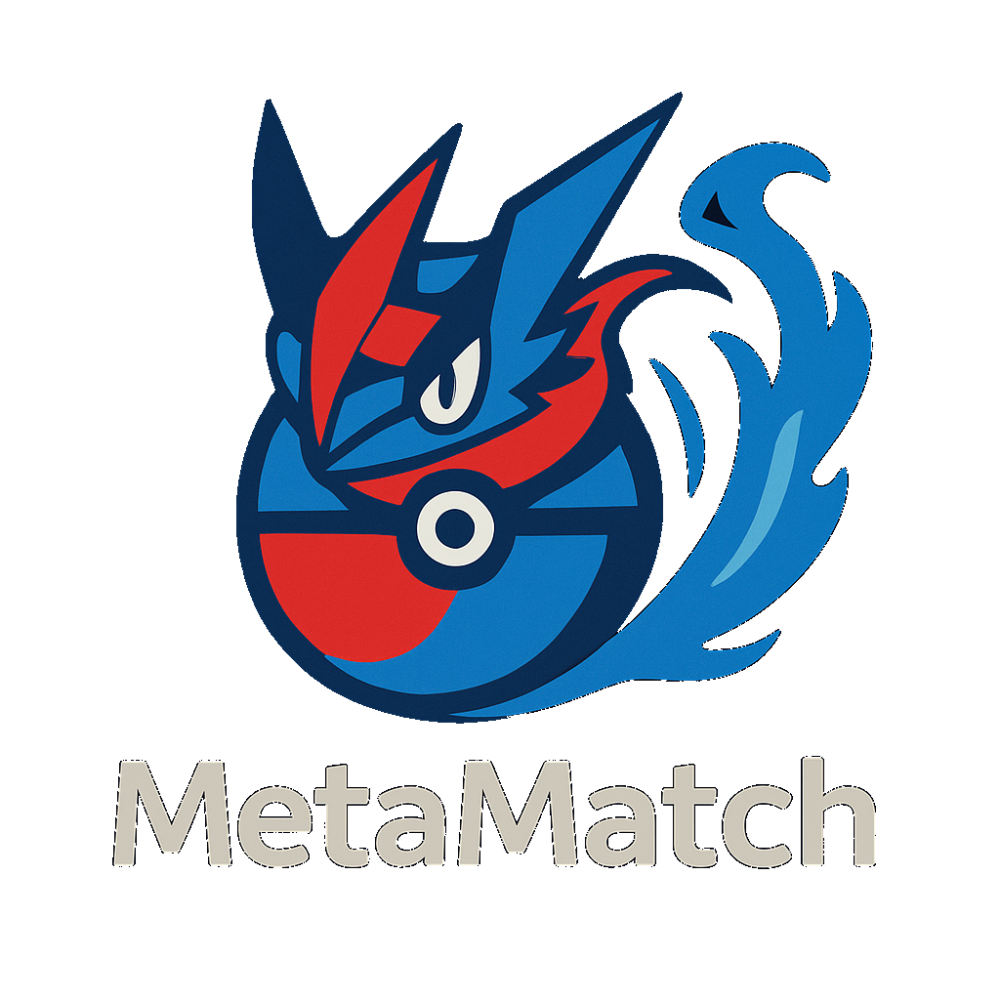
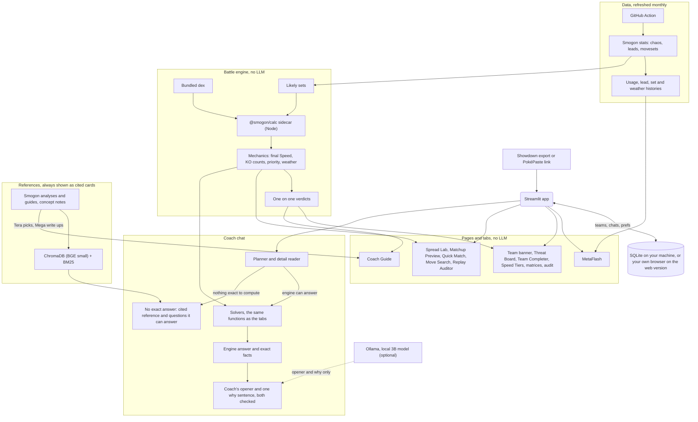
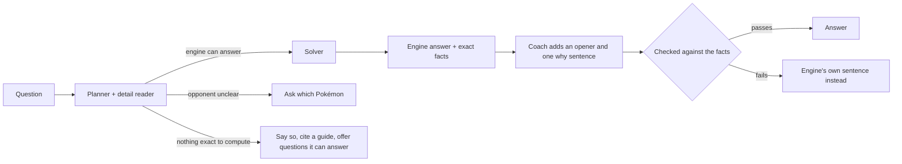

<p align="center">
  
</p>

<h1 align="center">MetaMatch</h1>

[](https://www.python.org/)
[](https://opensource.org/licenses/MIT)

Built with [Streamlit](https://streamlit.io/), [Ollama](https://ollama.com/), the [Smogon damage calc](https://github.com/smogon/damage-calc) and [ChromaDB](https://www.trychroma.com/).

**[Try it live](https://metamatch.streamlit.app)** or **[take the visual tour](showcase/)**, every screen of the app with real data and real coach answers.

**MetaMatch** is a hybrid AI system for competitive Pokémon team analysis that runs on your own laptop, with a free web version to try it. It pairs a deterministic battle engine (the official Smogon damage calculator, monthly ladder statistics, type and role logic) with a small local LLM, on one principle:

> ### The engine does the thinking. The LLM does the talking.

Every factual answer (damage rolls, KOs, speed, immunities, stats, usage) is computed by code before the model ever sees the question. The LLM only explains a verdict that is already correct, and a verifier throws out any explanation that contradicts it.

Paste your team, and MetaMatch tells you what beats it, what it beats, how to lead, when to Tera and what to change, then lets you ask three coaches anything about it in plain words. *(Curious how well that holds up? The numbers are in [bench/README.md](bench/README.md).)*

* ⚡ **Instant:** a full team analysis lands in about a second, with no GPU needed for anything but chat.
* 🔌 **Works offline:** every analysis tab runs on the engine alone. The LLM is an upgrade, not a dependency.
* 🔒 **Private:** on your own copy your teams never leave your machine, and on the web version they stay in your own browser. No API keys, no paid models.
* 📡 **Always current:** MetaFlash turns every month of Smogon ladder data since Gen 9 began into a live meta front page, refreshed every month by CI.
* 🔗 **Every team has a link:** dashboards live at their own URL, so refresh, bookmarks, Back and a second tab all just work.


---

## How It Works



Everything above the chat is plain code: the dashboard, MetaFlash, the Coach Guide and every tool work without any language model. The model only ever adds the coach's voice to an answer the engine already worked out.

A GitHub Action pulls Smogon's stats every month and rebuilds the histories, speed tiers and weather rosters in one all or nothing step. The test gate answers from a pinned stats snapshot, so a new month of data can never break CI or shift the answer keys.

### How a coach answers



1. **Planner (zero LLM):** works out what the question asks (speed, damage, a KO, a type matchup, a set, a matchup, a game plan and so on) and which Pokémon, move and set are involved. Recognizes all 1,400+ species and formes in the bundled dex, plus nicknames (*Lando*, *Pult*, *Tusk*), regional shorthand (*G Slowking*), typos and Mega names, and follow ups like *"what about Gholdengo?"* or *"why?"*.
2. **Detail reader (zero LLM):** picks up everything the question says about either side, like *"max speed"*, *"specs"*, *"tera fairy"*, *"+2 after a Dragon Dance"*, Reflect, rain or a pasted set, and knows which Pokémon it belongs to. It also reads battle conditions: Tailwind, Trick Room, a burn or paralysis, an HP percentage, Stealth Rock, Spikes or a critical hit, and the answer says what it counted. Anything it can't model, like Sticky Web, is named instead of dropped.
3. **Solver:** computes the answer with the real damage calculator and the same functions the dashboard tabs use, so the chat and the tabs never disagree. Anything you didn't state comes from the most common ladder set, and the answer says which is which.
4. **The answer is written by code:** the sentence that answers the question is a template filled in by the engine, never the model's guess. The exact numbers, and any Smogon analysis on the Pokémon, sit in a dropdown under it.
5. **The coach adds a voice, checked:** the local model writes a short opener and one sentence on why. The opener may not state any fact. The why sentence must restate one of the engine's facts: every number, Pokémon, move and verdict is checked, and if it drifts, the engine's own sentence is shown instead.
6. **No guessing:** a question the engine has no exact answer for gets an honest "can't work that out exactly", the closest Smogon guide or concept note as a cited card, and clickable questions it can answer.
7. **Works without the model:** with no model running, each coach uses a stock opener and the engine's facts. That's how the web version runs.

---

## Features

### MetaFlash: The Meta Front Page

The home screen opens on a magazine style front page of what the ladder is doing right now, for whichever format you pick.


* **Story of the month:** the biggest move in the top 10, with its usage, rank change, standard set, common partners, a 12 month chart and its all time peak.
* **Top 10 leaderboard:** usage bars in each Pokémon's type colour and rank changes versus last month.
* **Story cards:** the #1, the biggest risers and fallers, newcomers breaking into the top 30, and the fastest of the top 20, each with its standard set and a trend line. Hover or tap any Pokémon for its rank, usage and usual item.
* **Speed to beat:** the usual Speed of the five fastest of the 25 most used Pokémon, with how many carry Choice Scarf or Booster Energy.
* **Every month on record:** a month picker goes back to November 2022 (Champions formats since launch), so you can open any past meta.
* **Leads to expect:** the Pokémon that open games most often, with rank changes, for planning team preview.
* **Top players' picks:** what the top of the ladder runs more than players at 1500+.
* **How sets changed:** the biggest shift in item, Tera, moves or ability among the top 25 each month, like Tera Ghost Cinderace jumping from 9% to 34%.
* **Rising cores:** pairs more teams are building together than last month.
* **Weather on the ladder:** how many teams run rain, sun or sand, and who they bring along (OU).
* **A year on:** this month's top 5 next to the same month last year, and the year's biggest climbs and drops.
* **Run the gauntlet:** on your own copy, each saved team against this month's top 12 threats, flagging ones that just entered the top 12 and climbing ones it barely answers.
* **Says how much data it rests on:** the header gives the month's battle count and flags a small sample.
* **Always this month's numbers:** the page updates itself as soon as Smogon publishes a new month.

### Pages, Links & Memory

* **Every tool one click away:** Home, Team, Quick Match, Move Search, Spread Lab, Matchup Preview and Replay Auditor sit in the top bar.
* **Every team has its own link:** refresh, bookmark it, open it in a second tab or go Back, and your dashboard is still there.
* **Pick up where you left off:** your last teams sit in the sidebar as sprite cards, one click from reopening.
* **A coach chat per team:** each team keeps its own conversation, and it survives a refresh.
* **Always up to date:** reopening a saved team checks it against this month's stats.
* **Guided tour:** first time visitors get a one minute spotlight walkthrough of the real app on the sample team, and it is always one click away in the sidebar.
* **Your teams stay yours:** on your own copy they're saved on your machine; on the web version they stay in your own browser, so nobody sees anyone else's.

### The Coaches

Three coaches, each answering the questions in their area:

* **Clemont (Speed, types and mechanics):** who outspeeds whom, damage and KOs, what a member is weak to, and how moves, abilities and items work, from the calc, the type chart and Showdown's rules.
* **Professor Oak (Matchups and game plan):** how to beat a Pokémon, who switches into it, leads, win conditions, weather, and how to play against rain, sun, sand, stall or hazard stacking, each checked one on one against the real ladder roster.
* **Brock (Sets and building):** what a Pokémon usually runs, which of two options to pick, teammates and Tera types, with Smogon's recommendation and exact ladder shares.
* **Points you to the full picture:** answers name the dashboard tab that shows more, and offer clickable follow up questions.
* **Help that teaches:** an empty chat opens on three coach cards with what each one answers, how to ask, and example questions to click.

### Real Damage Calculator

* Every damage roll, KO and Speed number comes from **Smogon's official damage calculator**, the same one Showdown players use.
* Speed answers count every spread the opponent runs on the ladder, not just one.
* Booster Energy, Protosynthesis and Quark Drive boosts count whenever they would trigger in battle.

### Team Audit

Instant checks on every team:

* **Team Check:** legality in plain English (species, moves, items, EV or stat point limits, Tera, Species Clause, Mega rules), a one click conversion between SV EVs and Champions stat points, and a downloadable team report to share.
* **Item and Ability Synergy Flags:** *Drought* without *Heat Rock*, *Guts* without an Orb, *Magic Guard* without *Life Orb*, each with a plain English explanation.
* **Role Gap Detection:** flags a missing *Hazard Setter*, *Hazard Remover* or *Pivot*.
* **Type Coverage Holes:** types none of your damaging moves hit super effectively.
* **Usage Warnings:** moves and items under 5% ladder usage, with the most common alternatives.
* **Role Detection:** about 35 competitive roles (*Wall, Setup Sweeper, Stallbreaker, Forced Switcher...*) and team archetypes (*Hyper Offense, Stall, Volt Turn, Weather, Trick Room*).

### Threat Board

Your whole team against the format's 12 most used Pokémon, one matchup at a time, every verdict worked out by the real damage calculator.

* **See every matchup at a glance:** a win or lose grid, with each threat's usage beside it.
* **Hover for the full story:** who moves first, the best hit each way and how many hits each side needs.
* **Spot your holes:** threats with no answer or only one are called out, along with your weakest matchup.
* **Ask in chat:** *"what checks Kyurem?"* gets the same answer in words.

### Team Completer

Most recommenders suggest whatever is popular. The Team Completer picks your next teammate by what it adds.

* **Fixes your weak spots:** candidates are ranked by which of your thin matchups they actually beat, checked by the damage calculator.
* **Real pairings, not popularity:** shows how often players put each pick next to your Pokémon, compared with an average team. Hover for the numbers.
* **Fills missing roles:** flags picks that add a hazard setter, hazard removal or a pivot.
* **Calls out filler:** popular picks that wouldn't fix anything are shown separately, so you don't waste the slot.
* **Works with full teams too:** choose the member you'd swap and get its replacements.
* **Quick Match:** no team yet? Pick 1 to 5 Pokémon and get the partners players actually build with them in your format, with the numbers on hover.

### Speed Tiers

Speed against what players actually run, not a guess.

* **Real spreads for your format:** every spread the top 25 Pokémon run this month, with Choice Scarf sets marked.
* **Your true Speed:** worked out with your item and IVs, so Choice Scarf and Trick Room sets are right.
* **What if?:** pick a Speed or a benchmark and see who you'd outspeed more of, and what it costs in EVs or nature.

### Spread Lab

Tell it what your Pokémon needs to do and it finds the smallest spread that does all of it.

* **Pick your benchmarks:** outspeed a threat (its usual spread or every common one, even with Choice Scarf), OHKO or 2HKO a target, or survive a specific hit.
* **The least investment:** the smallest spread that hits every benchmark, double checked before it's shown.
* **Honest about the impossible:** a benchmark no spread can reach is named, with the reason, and the rest are still solved.
* **Compared with the ladder:** shows how the most common spreads do on the same benchmarks, and gives you a ready to paste set.
* **Champions ready:** works in stat points with the 66 point budget.

### Matchup Preview

Paste the team you're about to face, even just the six names from team preview.

* **Every matchup:** the same win or lose grid and hover detail as the Threat Board, using their sets exactly when you paste them.
* **Champions bring 3:** picks the three that hold up best against any three they could bring, checked against all 20 of their options.

### Coach Guide

A game plan for your team.

* **Built from your matchups:** every line comes from the Threat Board, Speed Tiers and type chart, so it only names moves your team actually runs.
* **Knows what your team is built around:** finds your sun, rain, sand, snow, terrain, Trick Room, Tailwind or screens core and measures it with the calc, like a Chlorophyll Venusaur going from 284 to 568 Speed behind Torkoal's sun, and notices when a core is missing its setter.
* **Reads abilities:** shows what each ability really does for your team, like Multiscale letting Dragonite survive any single hit from 11 of the 12 most used Pokémon instead of 7. Hover any ability on the team banner for what it does.
* **The whole plan:** your win condition and what to remove before it can sweep, two leads, a Tera plan (Mega Evolution in Champions and National Dex), pairs that cover each other, and the threats to watch.
* **Answers to the threats to watch:** for each threat your team struggles with, who switches into it and who knocks it out, with the damage on hover.
* **Your six at a glance:** each member's job, the top threats it can safely switch into, and the ones it has to get out against.
* **Hazard plan:** what Stealth Rock and Spikes take from each member every time it comes in, who sets and clears them on your team, and which top Pokémon bring them.
* **One fix that helps most:** names your team's biggest hole and the single swap that covers it, one click from all the options.
* **Tera picks from Smogon and the ladder:** every Tera card shows the Tera types on Smogon's set closest to yours and the ladder's top Tera shares, with your own pick ringed.
* **Mega Evolution cards (Champions and National Dex):** each Mega's stat changes as bars, its new typing and ability, and Smogon's write up of that Mega when one exists.
* **Leads that match real games:** the two suggested leads weigh hazards, weather and pivots with how often players actually open with each Pokémon.

### Multi Format

Gen 9 **OU, UU, National Dex**, plus **Pokémon Champions OU and UU** with Level 50 stats, stat points instead of EVs, and full Mega Evolution support.

### Set Finder & Move Search

* **Verified Sets:** official Smogon Strategy Dex sets with full spreads.
* **Experimental Matches:** Pokémon the ladder runs with your move combo, including niche tech nobody has written up yet.

### Replay Auditor

Paste a Showdown replay link (shared and private links both work) and get a review of the game. Every review gets its own link, so you can reopen or share it.

* **Reads every battle right:** Illusion, Mega Evolution, forme changes and Champions' bring 3 are all handled.
* **Versus banner:** both teams as sprites, who is left on each side and the result.
* **Team Health Chart** turn by turn with a dot on every faint, and a **Faint Timeline** with the real cause of every KO: the move, hazards, status, recoil, Destiny Bond or Perish Song.
* **Mistakes and Notes**, each dated to its turn: losing your only hazard remover, letting a setup sweeper run through you, moves into immune targets, bounced hazards, Destiny Bond and hazard chip.
* **Both teams at the end:** how each Pokémon finished (HP, status, hazard chip taken) and every item, ability, Tera type and move the opponent showed.

---

## Setup

### Prerequisites

1. **Python 3.10+**
2. **Node.js 18+** for the damage calculator.
3. **[Ollama](https://ollama.com/)**, then pull the model:

   ```bash
   ollama pull llama3.2:3b-instruct-q4_K_M
   ```

   To try another local model, set `LLM_MODEL` in `.env` (for example `LLM_MODEL=gemma3:4b`).

### Install & Run

```bash
git clone https://github.com/NamikazeAsh/MetaMatch.git
cd MetaMatch
pip install -r requirements_llm.txt        # or requirements.txt to skip the coach's strategy search
cd src/metamatch/engine && npm install && cd ../../..

python scripts/update_meta.py              # usage stats, top Pokémon, speed tiers
python scripts/build_strategy_cache.py     # Smogon sets for move search
python src/metamatch/rag/build_index.py    # vector index for the coach
python scripts/backfill_usage_history.py   # optional: rebuild MetaFlash's history since Nov 2022 (it ships in the repo)
python scripts/build_ability_text.py       # optional: refresh the ability descriptions from Showdown (they ship in the repo)

streamlit run src/metamatch/app.py        # run from the repo root so the dark theme loads
```

Ollama and Node are both optional. Without Ollama, every analysis tab still works and chat answers with the engine's facts; Oak's prose comes back as soon as Ollama starts. Without Node, chat falls back to type matchups instead of real damage numbers.

---

## Tests

```bash
pytest
```

The benchmarks, their results and the commands that run them are in [bench/README.md](bench/README.md).

---

## Module Overview

| Path                                             | What it does                                                                                                                                                                                                      |
| :----------------------------------------------- | :---------------------------------------------------------------------------------------------------------------------------------------------------------------------------------------------------------------- |
| `src/metamatch/app.py`, `tabs/`              | Streamlit app, one module per tab                                                                                                                                                                                 |
| `src/metamatch/engine/`                        | Damage calc bridge, dex, likely sets, query planner, constraint parser, solvers, shared mechanics, name matching, Threat Board, Team Completer, Speed Tiers, Spread Lab, Matchup Preview, Team Check, Coach Guide |
| `src/metamatch/agents/`                        | Manager (topic routing, follow ups, declines), the answer voice and its checks, open question fallback, the three coaches ([details](src/metamatch/agents/README.md))                                              |
| `src/metamatch/rag/`                           | Analyses for every SV format, usage cards, guides, chunking, hybrid ChromaDB + BM25 store ([details](src/metamatch/rag/README.md))                                                                                 |
| `src/metamatch/team.py`                        | Showdown parser, role detection, type math, Mega handling                                                                                                                                                         |
| `src/metamatch/suggestions.py`                 | Team audit and threat scoring                                                                                                                                                                                     |
| `src/metamatch/recommender.py`, `auditor.py` | Teammate synergy and usage checks from chaos data                                                                                                                                                                 |
| `src/metamatch/replay/`                        | Showdown protocol parser, team health, mistake and note rules                                                                                                                                                     |
| `src/metamatch/meta_pulse.py`                  | MetaFlash: usage history, story selection rules, leaderboard, template headlines                                                                                                                                  |
| `src/metamatch/meta_trends.py`                 | MetaFlash trends: leads, set changes, top players' picks, rising cores, saved team report                                                                                                                         |
| `src/metamatch/storage.py`                     | SQLite store for teams, per team chats and preferences, with a one time import of the old JSON saves                                                                                                              |
| `src/metamatch/browser_store.py`               | The same store kept in each visitor's own browser on the web version                                                                                                                                              |
| `scripts/update_meta.py`                       | Monthly stats pipeline (also run by GitHub Actions), including the MetaFlash histories                                                                                                                            |
| `bench/`                                       | MetaBench question generators, runner, grader, report, and pinned stats snapshots in `bench/fixtures/`                                                                                                          |
| `bench/extraction/`, `bench/rag/`            | Question understanding benchmark (260 labelled questions) and retrieval benchmark                                                                                                                                 |
| `bench/guide/`                                 | Coach Guide lead check against the leads in local ladder replays                                                                                                                                                  |

---

## Limitations & Future Outlook

* **Strategy is the frontier.** Facts are solved, and questions with no exact answer get cited references instead of made up advice, but open ended strategy is not benchmarked yet. A rubric graded strategy benchmark is next.
* **Fresh set results.** The first run of the [201 question frozen set](bench/README.md#frozen-fresh-test-set) showed MetaMatch skipping details people stated, like a given spread or Tera, which is what the new detail reader fixes. A second blind set comes next to measure it.
* **Assumed sets.** Anything you don't state comes from the most common ladder set. Sticky Web, doubles effects like Helping Hand, and plans over several turns aren't modelled yet, and the answer says so.
* **Champions data.** Smogon has written up only about 57 Champions Pokémon so far, so many have no analysis yet, and verified sets are SV only.

**The bet:** you should not need a frontier model to calculate a Speed stat. Code is perfect for rules, language models are good at explaining them, and keeping everything local means your teams stay private. MetaMatch is a proof that a small model that knows how to use tools can beat a raw model at the same size by a wide margin.

---

## Acknowledgements

* **[Smogon University](https://www.smogon.com/)**: usage statistics, strategy analyses and [`@smogon/calc`](https://github.com/smogon/damage-calc).
* **[PokeAPI](https://pokeapi.co/)**: Pokémon relational data.
* **[Pokémon Showdown](https://pokemonshowdown.com/)**: Pokémon HOME sprites, served from its sprite server, and ability and mechanics text from its [server repo](https://github.com/smogon/pokemon-showdown) (MIT).
* **[Ollama](https://ollama.com/)**: local LLM runtime.
* **[Streamlit](https://streamlit.io/)**: dashboard framework.
