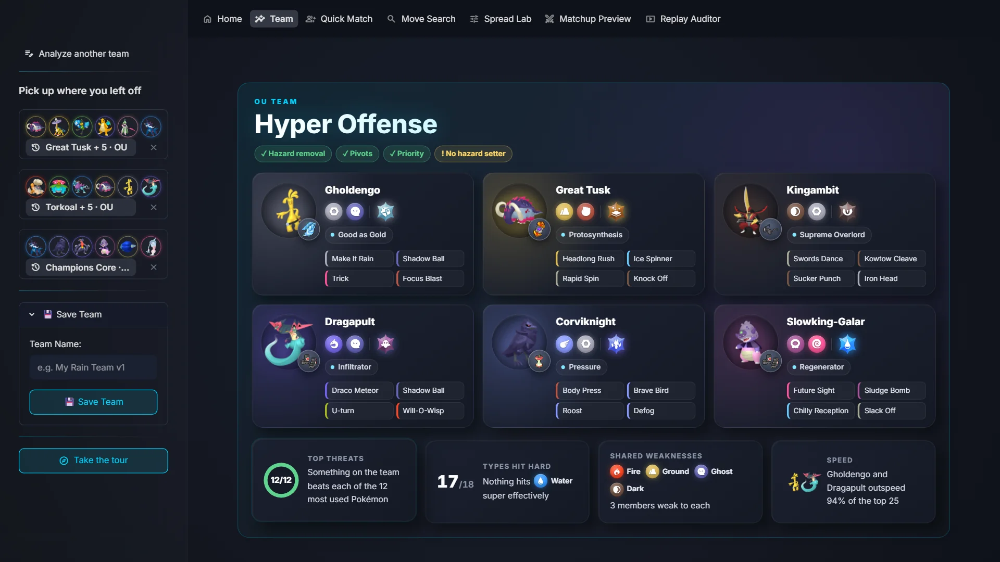
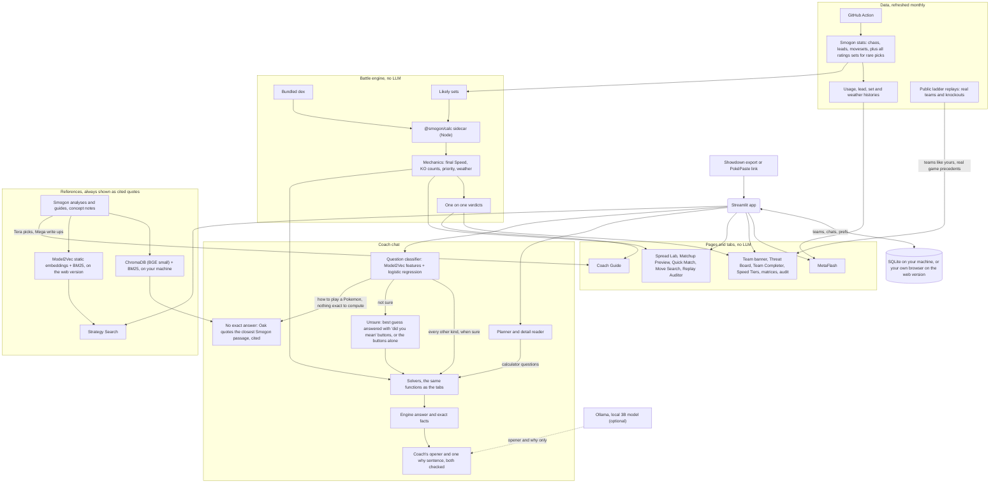
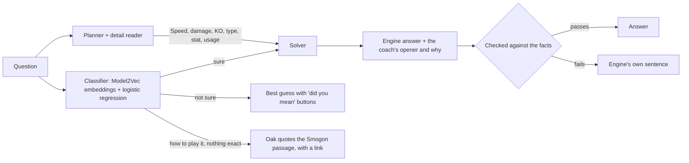
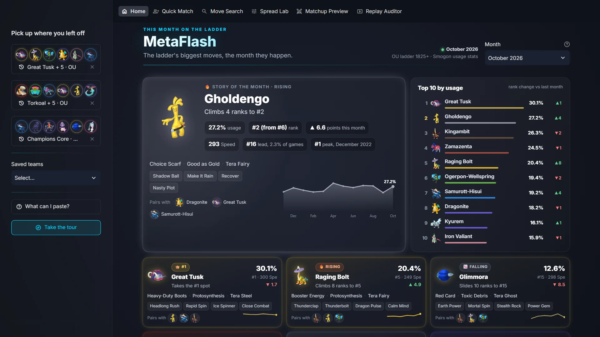

<p align="center">
  
</p>

<h1 align="center">MetaMatch</h1>

[](https://www.python.org/)
[](https://opensource.org/licenses/MIT)

Built with [Streamlit](https://streamlit.io/), [Ollama](https://ollama.com/), the [Smogon damage calc](https://github.com/smogon/damage-calc) and [ChromaDB](https://www.trychroma.com/).

**[Try it live](https://metamatch.streamlit.app)**

**MetaMatch** is a competitive Pokémon coach that runs on your laptop, with a free web version. It pairs a deterministic battle engine (Smogon's damage calculator, monthly ladder stats, type and role logic) with a small local LLM, on one principle:

> ### The engine does the thinking. The LLM does the talking.

Every fact (damage, KOs, Speed, immunities, stats, usage) is computed by code before the model sees the question. The model only phrases a verdict that is already correct, and a checker rejects anything that contradicts it. *(Results: [bench/README.md](bench/README.md).)*

Paste a team and MetaMatch shows what beats it, what it beats, how to lead, when to Tera and what to change. Then ask three coaches anything about it.

* **Fast and offline:** a full analysis in about a second, no GPU, and every tab works without the LLM.
* **Private and free:** your teams stay on your machine, or in your own browser on the web version. No API keys, no paid models.
* **Always current:** refreshed every month from Smogon's ladder data.



---

## ⚙️ How It Works



Everything outside the chat is plain code. The model only adds the coach's voice to an answer the engine already worked out.

A monthly GitHub Action pulls Smogon's stats and rebuilds the histories in one all or nothing step. Tests answer from a pinned snapshot, so new data never breaks CI.

### How a coach answers



1. **Classifier:** a logistic regression over Model2Vec embeddings (potion retrieval 32M) plus cue words, trained on about 2,000 labelled questions. It reads the question with the names swapped out ("does my pokemon outspeed their pokemon") and picks one of 29 kinds. When it isn't sure, it answers its best guess with "did you mean" buttons underneath. Plain numpy, so it runs on the live site too.
2. **Planner and detail reader:** find the Pokémon and moves, nicknames like *Lando* and *Tusk*, follow ups like *"what about Gholdengo?"* and stated details like *"specs"*, *"+2"*, rain or Trick Room. Anything it can't model is named, not dropped.
3. **Solver:** computes the answer with the damage calculator and the same functions as the dashboard, so chat and tabs always agree. Details you didn't state come from the most common ladder set.
4. **Checked voice:** the engine writes the answer and the local model adds an opener and one "why" sentence. If any number, Pokémon or verdict in it drifts from the engine, the engine's own sentence is shown instead.
5. **No guessing:** with nothing exact to compute, Oak quotes the Smogon passage that answers it, with a link, or says so. Without the model, the coaches use stock openers and the engine's facts.

---

## 📦 Features

### MetaFlash

The home page: what the ladder is doing this month, for any format.



* **Story of the month:** the biggest move in the top 10, with its set, partners and a 12 month chart.
* **Top 10 and movers:** usage bars, risers, fallers, newcomers and the fastest of the top 20.
* **Meta trends:** leads to expect, what top players run, set shifts (Tera Ghost Cinderace from 9% to 34%), rising cores and weather.
* **Every month since November 2022,** plus a year on comparison.
* **Run the gauntlet:** each saved team against this month's top 12, on your own copy.

### Pages and Memory

* **Every tool in the top bar,** each with a "How it works" guide.
* **Every team has its own link** that survives refresh, bookmarks and Back.
* **Recent teams in the sidebar,** each with its own coach chat.
* **A one minute guided tour** for first time visitors.

### The Coaches

* **Clemont:** Speed, damage, KOs, types and mechanics.
* **Professor Oak:** matchups, switch ins, leads, win conditions, weather and archetypes, plus Smogon's advice when there's nothing exact to compute.
* **Brock:** sets, comparisons that pick an option, teammates and Tera types, from Smogon and ladder shares.

On the live site, where no model runs, the chat tab becomes **Strategy Search**: the Smogon passages that best answer your question, with the writers credited.

### Real Damage Calculator

Every damage roll, KO and Speed number comes from Smogon's official calculator. Speed counts every spread the opponent runs, and Booster Energy, Protosynthesis and Quark Drive trigger when they would in battle.

### Team Audit

* **Legality in plain English:** moves, items, EVs or stat points, Tera, Species Clause and Megas, plus a downloadable report.
* **Synergy flags:** *Drought* without *Heat Rock*, *Guts* without an Orb.
* **Gaps:** a missing hazard setter, remover or pivot, types none of your moves hit super effectively, and moves or items under 5% usage.

### Threat Board

Your team against the format's 12 most used Pokémon, every verdict from the calc. Hover a cell for who moves first and the hits each way. Holes are called out, and for a threat you pick, a public replay shows a team like yours knocking it out.

### Team Completer

Picks your next teammate by what it adds, not by popularity: threats it beats that you struggle with, roles it fills, and how often players pair it with your team. Popular filler is shown separately.

* **Teams like yours:** the real ladder teams closest to yours, with replay links and what they run instead ("17 of your 20 closest teams don't run Gholdengo").
* **Quick Match:** no team? Pick a Pokémon, add the partners players build with it (rare picks included), then analyze, export or share it as a PokéPaste.

### Speed Tiers

Every spread the top 25 Pokémon run this month, your true Speed with your item, and what it costs to outspeed more of them.

### Spread Lab

Pick benchmarks (outspeed a threat, OHKO or 2HKO a target, survive a hit) and get the smallest spread that meets them all, compared with the ladder's spreads and ready to paste. A benchmark no spread can reach is named with the reason. Works with Champions stat points.

### Matchup Preview

Paste the team you're facing, even just the six names from team preview, for every matchup. In Champions it picks your best three to bring.

### Coach Guide

A game plan built from your matchups, so it only names moves your team actually runs.

* **The plan:** your win condition and what to remove first, two leads, a Tera or Mega plan, pairs that cover each other, and the threats to watch with who answers them.
* **Cores and abilities, measured:** Chlorophyll Venusaur going from 284 to 568 Speed behind Torkoal's sun, or Multiscale Dragonite surviving any hit from 11 of the top 12 instead of 7.
* **Your six and your walls:** each member's job, what it can switch into, and what each defender walls or must avoid.
* **Hazards and one fix:** what Stealth Rock and Spikes cost each member, and the single swap that closes your biggest hole.

### Move Search

Pick up to four moves to see every Pokémon that runs them together, how often they come as a combo, and who can learn them but rarely does. Add any result to Quick Match in one click.

### Replay Auditor

Paste a Showdown replay link for a turn by turn review: a health chart, the real cause of every faint, mistakes dated to their turn, and everything the opponent revealed. Handles Illusion, Megas, forme changes and Champions' bring 3, and every review gets its own link.

### Formats

Gen 9 **OU, UU and National Dex**, plus **Pokémon Champions OU and UU** with Level 50 stats, stat points and Megas.

---

## 🛠️ Setup

### Prerequisites

1. **Python 3.10+**
2. **Node.js 18+** for the damage calculator.
3. **[Ollama](https://ollama.com/)**, then pull the model:

   ```bash
   ollama pull llama3.2:3b-instruct-q4_K_M
   ```

   To try another local model, set `LLM_MODEL` in `.env` (for example `LLM_MODEL=gemma3:4b`).

### Install & Run

```bash
git clone https://github.com/NamikazeAsh/MetaMatch.git
cd MetaMatch
pip install -r requirements_llm.txt        # or requirements.txt to skip the coach's strategy search
cd src/metamatch/engine && npm install && cd ../../..

python scripts/update_meta.py              # usage stats, top Pokémon, speed tiers
python scripts/build_strategy_cache.py     # Smogon sets for move search
python src/metamatch/rag/build_index.py    # vector index for the coach
python scripts/backfill_usage_history.py   # optional: rebuild MetaFlash's history since Nov 2022 (it ships in the repo)
python scripts/build_ability_text.py       # optional: refresh the ability descriptions from Showdown (they ship in the repo)

streamlit run src/metamatch/app.py        # run from the repo root so the dark theme loads
```

Ollama and Node are both optional. Without Ollama, every analysis tab still works and chat answers with the engine's facts; Oak's prose comes back as soon as Ollama starts. Without Node, chat falls back to type matchups instead of real damage numbers.

---

## 🧪 Tests

```bash
pytest
```

The benchmarks, their results and the commands that run them are in [bench/README.md](bench/README.md).

---

## 🧩 Module Overview

<details>
<summary>Where things live</summary>

| Path | What it does |
| :--- | :--- |
| `src/metamatch/app.py`, `tabs/` | Streamlit app, one module per tab |
| `src/metamatch/engine/` | Damage calc bridge, dex, likely sets, planner, solvers, mechanics, Threat Board, Team Completer, Speed Tiers, Spread Lab, Coach Guide |
| `src/metamatch/engine/intent.py` | The question classifier (trained by `scripts/train_intent.py` on `data/intent/`) |
| `src/metamatch/engine/team_neighbors.py`, `precedents.py` | Teams like yours and real game precedents, from `data/json/ladder_teams.json` |
| `src/metamatch/agents/` | Routing, follow ups, declines, the answer voice and its checks, the three coaches |
| `src/metamatch/rag/` | Smogon analyses, guides, chunking, the ChromaDB + BM25 store and the lightweight web search (`lite.py`) |
| `src/metamatch/team.py` | Showdown parser, role detection, type math, Mega handling |
| `src/metamatch/replay/` | Replay parser, team health, mistake rules |
| `src/metamatch/meta_pulse.py`, `meta_trends.py` | MetaFlash stories, leaderboard and trends |
| `src/metamatch/storage.py`, `browser_store.py` | Teams, chats and prefs on disk, or in the visitor's browser |
| `scripts/update_meta.py` | Monthly stats pipeline, also run by GitHub Actions |
| `bench/` | MetaBench, the question understanding and retrieval benchmarks, pinned stats snapshots |

</details>

---

## ⚠️ Limitations & Future Outlook

* **Real questions are harder.** On 48 questions from Smogon's forums, 74% of the questions it answers get a useful answer, but "why does X run Y" and opinion questions often get "did you mean" instead.
* **Weak spots:** in battle calls (it can't see the game), Tera timing and open strategy.
* **Assumed sets.** Anything you don't state comes from the most common ladder set. Sticky Web, doubles effects and plans over several turns aren't modelled, and answers say so.
* **Champions data.** Smogon has written up only about 57 Champions Pokémon so far.

**The bet:** you shouldn't need a frontier model to calculate a Speed stat. Code is perfect for rules, small models are good at explaining them, and staying local keeps your teams private. MetaMatch shows that a small model with the right tools beats the same model on its own by a wide margin.

---

## Acknowledgements

* **[Smogon University](https://www.smogon.com/)**: usage statistics, strategy analyses and [`@smogon/calc`](https://github.com/smogon/damage-calc).
* **[PokeAPI](https://pokeapi.co/)**: Pokémon relational data.
* **[Pokémon Showdown](https://pokemonshowdown.com/)**: Pokémon HOME sprites, served from its sprite server, and ability and mechanics text from its [server repo](https://github.com/smogon/pokemon-showdown) (MIT).
* **[Ollama](https://ollama.com/)**: local LLM runtime.
* **[Streamlit](https://streamlit.io/)**: dashboard framework.
