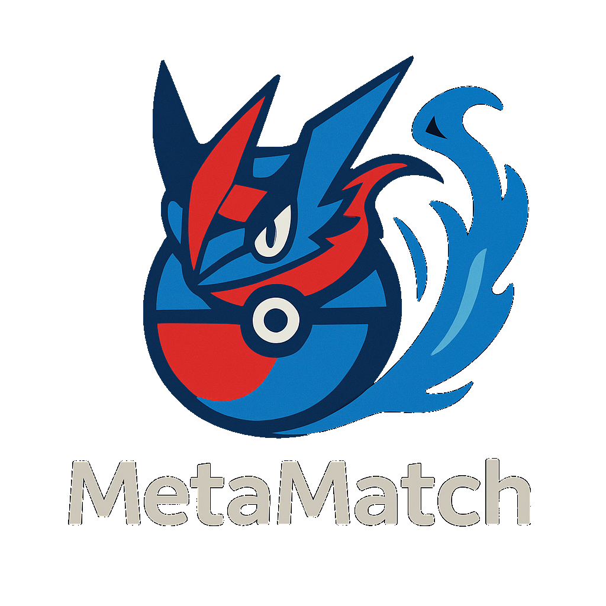
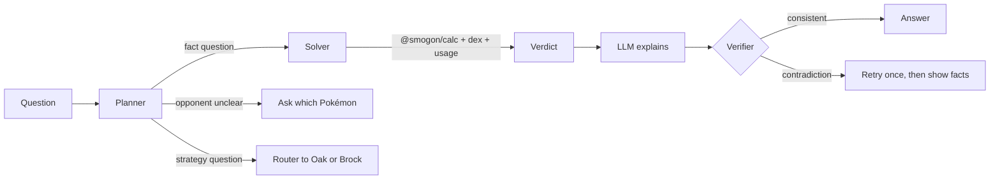
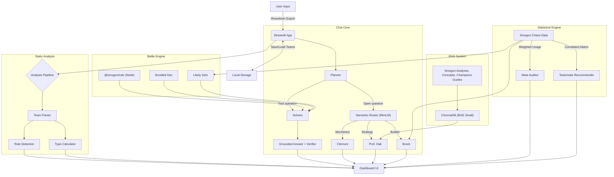

# MetaMatch

[](https://www.python.org/)
[](https://streamlit.io/)
[](https://ollama.com/)
[](https://github.com/smogon/damage-calc)
[](https://www.trychroma.com/)
[](#-metabench-the-metamatch-benchmarker)
[](https://opensource.org/licenses/MIT)

**MetaMatch** is a hybrid AI system for competitive Pokémon team analysis that runs entirely on a laptop. It pairs a deterministic battle engine (the official Smogon damage calculator, monthly ladder statistics, type and role logic) with a small local LLM, on one principle:

> ### 🧠 The engine does the thinking. The LLM does the talking.

Every factual answer (damage rolls, KOs, speed, immunities, stats, usage) is computed by code before the model ever sees the question. The LLM only explains a verdict that is already correct, and a verifier throws out any explanation that contradicts it.

**The result:** a 3B model on a 4 GB laptop GPU goes from **18% to 100%** on factual battle questions, and holds **94% and 97.5%** on blind held out sets.



---

## 📊 MetaBench: The MetaMatch Benchmarker

MetaBench is a 120 question benchmark across speed, KO, damage, type, stat and usage questions in SV and Champions formats. Every answer key comes straight from `@smogon/calc` and raw Smogon data, so nothing is graded on vibes.

| Question set                              | 🤖 Llama 3.2 3B alone | ⚪ MetaMatch (same 3B model) |
| :---------------------------------------- | :-------------------: | :--------------------------: |
| **Development set** (120)           |          18%          |        **100%**        |
| **Held out set 1** (reworded blind) |          25%          |        **94%**        |
| **Held out set 2** (written blind)  |          26%          |       **97.5%**       |

**Evaluation explained**

* **Development set:** 120 questions generated from the damage calculator and Smogon data, used while building MetaMatch.
* **Reworded blind:** the same 120 questions rewritten in formal wording by an agent that never saw the code.
* **Written blind:** the same 120 questions rewritten again in casual player style (lowercase, slang, swapped name order), also by an agent that never saw the code.

* **Overfitting check:** a high held out score means MetaMatch understands the question rather than memorizing the dev wording.
* **Fair grading:** free form answers are graded by a second local model (Gemma 3 4B) that was validated at 100% agreement (100 of 100) with strict `ANSWER:` line grading before use.
* **Fully local:** no paid APIs anywhere, for answering or for grading.

### 🧪 Real Answers From the Benchmark

Same model, same team, same question. These are trimmed from the benchmark logs.

#### 1. The Speed Tie

**Q:** *Does my Iron Moth outspeed Ogerpon-Wellspring running its most common spread, ignoring items and abilities?*

* **Llama 3B alone:** "Your Iron Moth's base speed is 120 + 50 (from Quark Drive) = 170... it will outspeed Ogerpon-Wellspring." ❌ *(invented a stat formula)*
* **MetaMatch:** "Iron Moth (350 Speed) **speed ties** with Ogerpon-Wellspring (Jolly 252 Spe, 350 Speed). Across all Ogerpon-Wellspring sets on the ladder, Iron Moth outspeeds 26% and ties 74%." ✅

#### 2. The Kingambit Check

**Q:** *Does my Cinderace's Flamethrower OHKO a full health Kingambit running its most common set?*

* **Llama 3B alone:** "Kingambit's most common spread is the Choice Scarf... base 120 Speed becomes 240... Pyro Ball has a 10% chance to burn..." ❌ *(wrong item, wrong stats, wrong move)*
* **MetaMatch:** "Flamethrower does **34.7 to 41.6%** to Kingambit, so it does not OHKO (69.2% chance to 3HKO after Leftovers recovery)." ✅

#### 3. The Stat Check

**Q:** *What is my Cresselia's Speed stat at level 100?*

* **Llama 3B alone:** "Cresselia's base Speed is 120. With 252 EVs... 428." ❌
* **MetaMatch:** "Cresselia's Speed stat is **250**. HP 401, Attack 158, Defense 256, Special Attack 273, Special Defense 276, Speed 250." ✅

---

## ⚙️ How a Chat Answer Is Made



1. **🗺️ Planner (zero LLM):** works out what the question asks (speed, KO, damage, type, stat or usage) and which Pokémon, move and set are involved. Understands nicknames (*Lando*, *Pult*, *Tusk*), typos and Mega names.
2. **🧮 Solver:** computes the answer with the real damage calculator. Opponents get their most common ladder set unless the question gives one (*"Garchomp @ Choice Scarf, Jolly 252 Spe"*).
3. **📜 Verdict:** the headline answer comes from a template, so it is always the engine's answer, never the model's guess.
4. **🔍 Verifier:** the LLM writes a short explanation. Any number not in the facts, or any claim that flips the speed, type or KO verdict, gets rejected. One retry, then MetaMatch shows the raw facts instead.
5. **❓ Clarify:** if a matchup question names no recognizable opponent, MetaMatch asks rather than answering a different question.

### 📜 Grounded Strategy Advice

Strategy questions ("how do I play against Kingambit?", "what are my biggest threats?") follow the same principle. The engine draws the conclusions, the LLM explains them:

* **🧮 One on one verdicts:** for a named opponent, or each of the top meta threats, the calc works out hits to KO both ways plus speed for every team member, then labels who wins and who loses.
* **📋 Engine check:** those verdicts open the answer, written by code, so the key facts are always right:
  > **Vs Kingambit** answers: Corviknight, Garchomp, Torkoal; loses: Dragapult (OHKO'd by Sucker Punch), Venusaur, Alomomola
* **🔍 Advice verifier:** Professor Oak's advice is rejected if it invents numbers, mentions Pokémon that appear nowhere in the facts, calls a team member an answer to something it loses to, or gives a member a move it doesn't run. One retry, then only the engine check is shown.

---

## ✨ Features

### 🤖 Multi Agent Chat

Three specialist agents, each with its own persona and temperature:

* **Clemont (Tactician):** mechanics and math, backed by the grounded pipeline above.
* **Professor Oak (Coach):** win conditions and game plans, grounded with engine matchup verdicts (see above) and retrieval over Smogon analyses, strategy concepts and Champions community guides (ChromaDB + `bge-small-en-v1.5`). Sees full set context: item, ability, Tera type, nature, EVs, speed and roles.
* **Brock (Builder):** audits your sets against ladder usage and cites exact percentages.
* **Semantic Router:** MiniLM embeddings pick the right agent for open questions, with a confidence gate that falls back to Oak.
* **Named opponent awareness:** mention any Pokémon and the agents get its likely set card from usage stats.

### 🧮 Real Damage Calculator

* The official **`@smogon/calc`** runs as a lightweight Node sidecar the app talks to over JSON.
* Species, moves, items, abilities and the type chart are exported from the same package, so the app and the calc **never disagree**.
* Speed answers consider the opponent's whole ladder speed distribution, not just one spread.

### 🔍 Team Audit (Fully Deterministic)

Instant, zero LLM checks on every team:

* **Item and Ability Synergy Flags:** *Drought* without *Heat Rock*, *Guts* without an Orb, *Magic Guard* without *Life Orb*, each with a plain English explanation.
* **Role Gap Detection:** flags a missing *Hazard Setter*, *Hazard Remover* or *Pivot*.
* **Type Coverage Holes:** types none of your damaging moves hit super effectively.
* **Usage Warnings:** moves and items under 5% ladder usage, with the most common alternatives.
* **Role Detection:** about 35 competitive roles (*Wall, Setup Sweeper, Stallbreaker, Forced Switcher...*) and team archetypes (*Hyper Offense, Stall, Volt Turn, Weather, Trick Room*).

### ⚠️ Meta Threats

The top 5 threats to your specific team, scored by `members_hit² × ladder_usage%` so breadth beats raw popularity. Each threat shows which of your Pokémon can hit back, which resist its STABs, and its key moves by usage.

### 🤝 Teammate Recommender & Quick Match

* **Statistical Synergy:** teammate correlation matrices from Smogon chaos data covering millions of ladder battles.
* **Role Weighted Boosting:** candidates that fill a missing role get a ×1.2 boost and a gold *"Fills missing: Hazard Setter, Pivot"* badge.
* **Quick Match:** no team yet? Pick 1 to 5 Pokémon and get the best glue for your core.

### 🌐 Multi Format

Gen 9 **OU, UU, National Dex**, plus **Pokémon Champions OU and UU** with Level 50 stats, stat points instead of EVs, and full Mega Evolution support (Mega Stone holders map to their Mega forme's stats, ability and usage data).

### 🔎 Set Finder & Move Search

* **Verified Sets:** official Smogon Strategy Dex sets with full spreads.
* **Experimental Matches:** scans ladder usage for Pokémon running your move combo (over 1%), surfacing niche tech nobody has written up yet.

### 📼 Replay Auditor

Paste a Showdown replay link and get a post mortem:

* **Momentum Chart** turn by turn, and a **Faint Timeline** of who KO'd whom with what.
* **Blunder Detection:** losing your hazard remover early, setup fodder, wasted sweepers, hazard chip deaths, lost weather wars and momentum collapses.
* **Hazard Damage Summary** with Heavy Duty Boots recommendations.

### Self Updating Data

A GitHub Action pulls new Smogon usage stats every month, rebuilds top Pokémon and speed tiers, and commits them. Downloads are all or nothing, so months never mix.

---

## 🏗️ System Architecture



---

## 🚀 Setup

### Prerequisites

1. **Python 3.10+**
2. **Node.js 18+** for the damage calculator.
3. **[Ollama](https://ollama.com/)**, then pull the model:

   ```bash
   ollama pull llama3.2:3b-instruct-q4_K_M
   ```

   To try another local model, set `LLM_MODEL` in `.env` (for example `LLM_MODEL=gemma3:4b`).

### Install & Run

```bash
git clone https://github.com/NamikazeAsh/MetaMatch.git
cd MetaMatch
pip install -r requirements.txt
cd src/metamatch/engine && npm install && cd ../../..

python scripts/update_meta.py              # usage stats, top Pokémon, speed tiers
python scripts/build_strategy_cache.py     # Smogon sets for move search
python src/metamatch/rag/build_index.py    # vector index for the coach

streamlit run src/metamatch/app.py
```

Without Node the app still runs, but chat falls back to type matchups instead of real damage numbers.

---

## 🧪 Tests & Benchmark

```bash
pytest                                     # 82 tests: parsing, mechanics, planner, verifiers, strategy verdicts

python bench/run.py --arm raw              # bare model with the team pasted in
python bench/run.py --arm metamatch        # full pipeline
python bench/run.py --arm template         # planner and solver only, no LLM
python bench/run.py --arm metamatch --questions bench/questions_paraphrase2.jsonl --name held_out_2
python bench/report.py                     # accuracy by arm, format and category
```

---

## 🛠️ Module Overview

| Path                                             | What it does                                                                                                 |
| :----------------------------------------------- | :----------------------------------------------------------------------------------------------------------- |
| `src/metamatch/app.py`, `tabs/`              | Streamlit app, one module per tab                                                                            |
| `src/metamatch/engine/`                        | Damage calc bridge, dex, likely sets, query planner, solvers, name matching                                  |
| `src/metamatch/agents/`                        | Router, manager, grounded answerer and verifier, the three agents ([details](src/metamatch/agents/README.md)) |
| `src/metamatch/rag/`                           | Smogon scraper, Champions usage cards and guides, ChromaDB store ([details](src/metamatch/rag/README.md))     |
| `src/metamatch/team.py`                        | Showdown parser, role detection, type math, Mega handling                                                    |
| `src/metamatch/suggestions.py`                 | Team audit, threat scoring, team guide                                                                       |
| `src/metamatch/recommender.py`, `auditor.py` | Teammate synergy and usage checks from chaos data                                                            |
| `src/metamatch/replay.py`                      | Replay parsing, momentum and blunder detection                                                               |
| `scripts/update_meta.py`                       | Monthly stats pipeline (also run by GitHub Actions)                                                          |
| `bench/`                                       | MetaBench question generator, runner, grader and report                                                      |

---

## 🔮 Limitations & Future Outlook

* **Strategy is the frontier.** Facts are solved and Oak's matchup claims are verified, but open ended advice is not benchmarked yet, and the verifier can't catch every strategic mistake a 3B model makes. A rubric graded strategy benchmark is next.
* **Held out scope.** The held out sets test new wording, not new teams or matchups; a fresh set of unseen questions is still to come.
* **Assumed sets.** Damage numbers use the opponent's most common set unless you give one.
* **Champions data.** Smogon has no Champions analyses yet, so its retrieval uses usage cards and community guides, and verified sets are SV only.

**The bet:** you should not need a frontier model to calculate a Speed stat. Code is perfect for rules, language models are good at explaining them, and keeping everything local means your teams stay private. MetaMatch is a proof that a small model that knows how to use tools can beat a raw model at the same size by a wide margin.

---

## 🙏 Acknowledgements

* **[Smogon University](https://www.smogon.com/)**: usage statistics, strategy analyses and [`@smogon/calc`](https://github.com/smogon/damage-calc).
* **[PokeAPI](https://pokeapi.co/)**: Pokémon relational data.
* **[Ollama](https://ollama.com/)**: local LLM runtime.
* **[Streamlit](https://streamlit.io/)**: dashboard framework.
