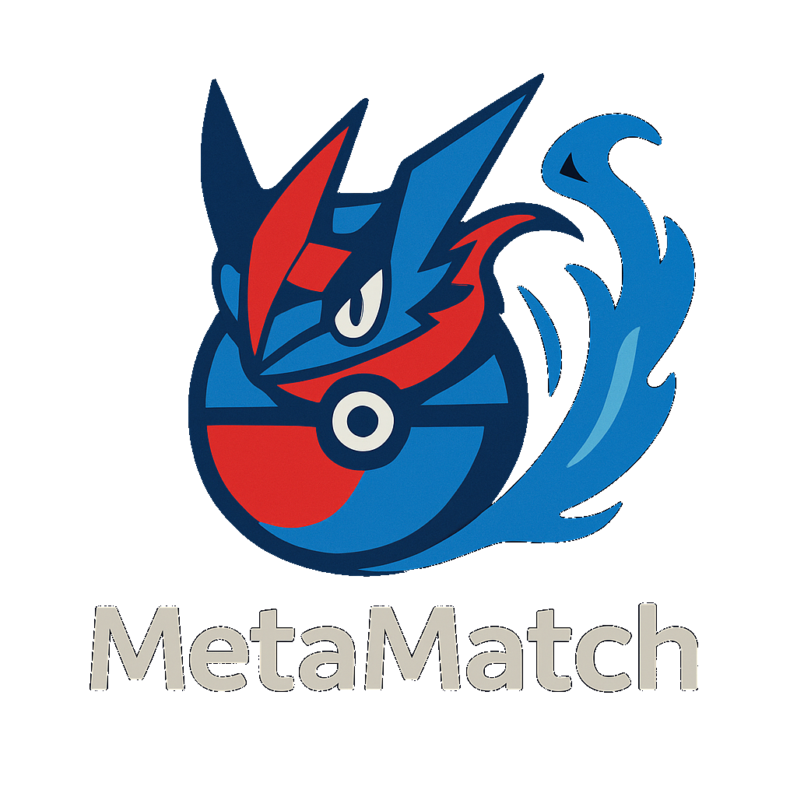
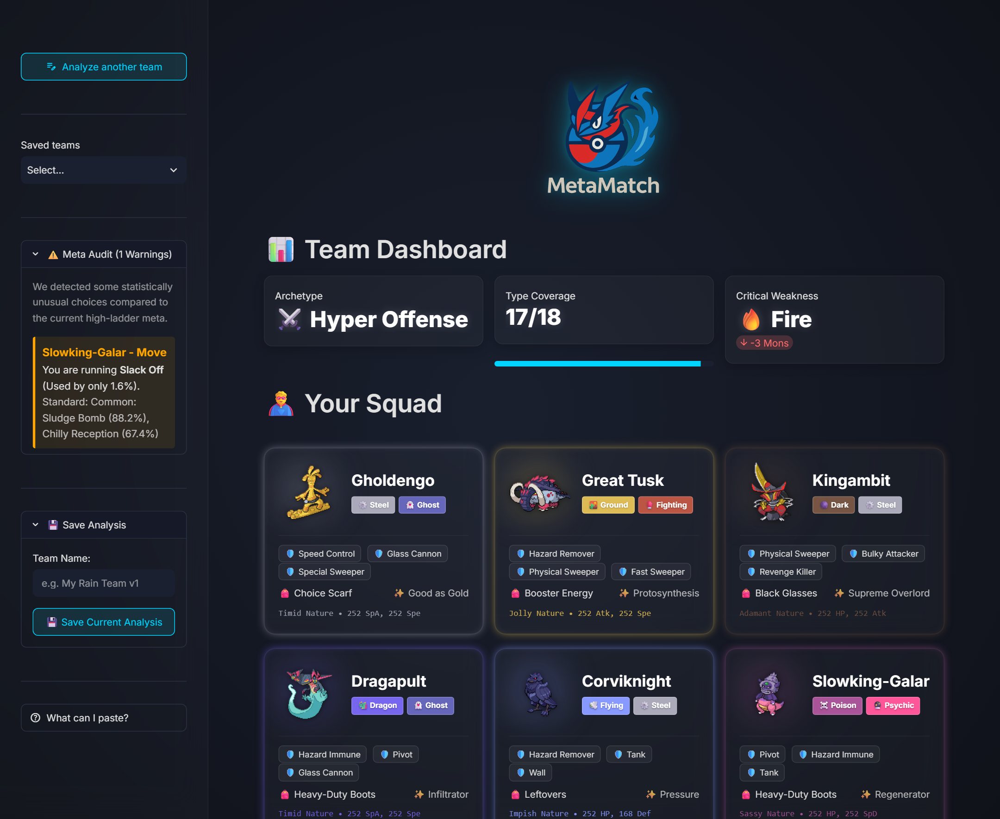
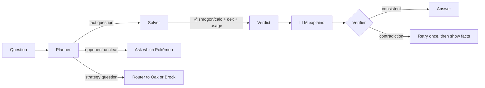
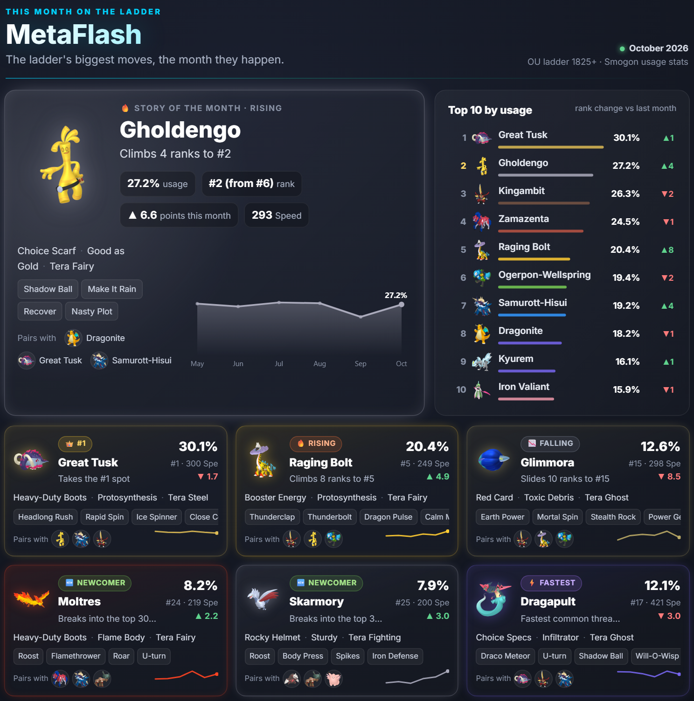
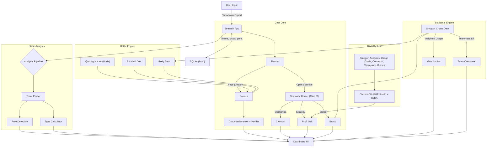

<p align="center">
  
</p>

<h1 align="center">MetaMatch</h1>

[](showcase/)
[](https://www.python.org/)
[](https://streamlit.io/)
[](https://ollama.com/)
[](https://github.com/smogon/damage-calc)
[](https://www.trychroma.com/)
[](#-metabench-the-metamatch-benchmarker)
[](#frozen-fresh-test-set)
[](#it-understands-what-you-actually-asked)
[](#it-finds-the-right-advice)
[](https://github.com/NamikazeAsh/MetaMatch/actions/workflows/tests.yml)
[](https://opensource.org/licenses/MIT)

**[Take the visual tour](showcase/)**, every screen of the app with real data and real coach answers.

**MetaMatch** is a hybrid AI system for competitive Pokémon team analysis that runs entirely on a laptop. It pairs a deterministic battle engine (the official Smogon damage calculator, monthly ladder statistics, type and role logic) with a small local LLM, on one principle:

> ### 🧠 The engine does the thinking. The LLM does the talking.

Every factual answer (damage rolls, KOs, speed, immunities, stats, usage) is computed by code before the model ever sees the question. The LLM only explains a verdict that is already correct, and a verifier throws out any explanation that contradicts it.

**The result:** a 3B model on a 4 GB laptop GPU goes from **18% to 100%** on factual battle questions, and holds **94% and 97.5%** on blind held out sets. It understands the details you throw at it (*"if it runs Timid 252 Spe"*, *"Tera Fairy"*, *"behind Reflect"*) and scores **93%** on a blind test of real player questions.

* ⚡ **Instant:** a full team analysis lands in about a second, with no GPU needed for anything but chat.
* 🔌 **Works offline:** every analysis tab runs on the engine alone. The LLM is an upgrade, not a dependency.
* 🔒 **Private:** your teams never leave your machine. No API keys, no cloud, no paid models.
* 🛡️ **Regression tested:** every push replays the benchmark through CI against a pinned stats snapshot.
* 📡 **Always current:** MetaFlash turns six months of Smogon ladder data into a live meta front page, refreshed every month by CI.
* 🔗 **Every team has a link:** dashboards live at their own URL, so refresh, bookmarks, Back and a second tab all just work.



---

## 📊 MetaBench: The MetaMatch Benchmarker

MetaBench is a 120 question benchmark across speed, KO, damage, type, stat and usage questions in SV and Champions formats. Every answer key comes straight from `@smogon/calc` and raw Smogon data, so nothing is graded on vibes.

| Question set                              | 🤖 Llama 3.2 3B alone | ⚪ MetaMatch (same 3B model) |
| :---------------------------------------- | :-------------------: | :--------------------------: |
| **Development set** (120)           |    18% (12 to 25)     |        **100%**        |
| **Held out set 1** (reworded blind) |    25% (18 to 33)     |   **94%** (90 to 98)   |
| **Held out set 2** (written blind)  |    26% (18 to 34)     |  **97.5%** (94 to 100) |

Brackets are bootstrap 95% confidence intervals. On held out set 2 MetaMatch beats the bare model by **+71.7 points** (paired 95% CI +63.3 to +79.2). It ties the planner and engine running with no LLM at all (+0.8 points, CI includes 0), which is the point: the engine produces the accuracy, and the LLM only has to explain it.

**Evaluation explained**

* **Development set:** 120 questions generated from the damage calculator and Smogon data, used while building MetaMatch.
* **Reworded blind:** the same 120 questions rewritten in formal wording by an agent that never saw the code.
* **Written blind:** the same 120 questions rewritten again in casual player style (lowercase, slang, swapped name order), also by an agent that never saw the code.

* **Overfitting check:** a high held out score means MetaMatch understands the question rather than memorizing the dev wording.
* **Fair grading:** free form answers are graded by a second local model (Gemma 3 4B) that was validated at 100% agreement (100 of 100) with strict `ANSWER:` line grading before use.
* **Fully local:** no paid APIs anywhere, for answering or for grading.

### Frozen Fresh Test Set

A second, harder round of evaluation: **201 brand new questions**, written and keyed independently of MetaMatch's code.

* **Harder than the originals:** Choice Scarf speed, opponent phrased questions (*"does Dragapult outspeed my Great Tusk?"*), KO and survive checks with no move named, Sturdy and Focus Sash, sun and screens, defensive Tera, regional and Rotom formes, nicknames, plus 40 hand written questions in real player slang.
* **New Pokémon:** drawn from usage ranks 41 to 80, so none overlap the original question pool.
* **Independent answer keys:** generated by a separate script that imports nothing from MetaMatch, then recomputed from scratch by a second independent pass. All 201 keys agreed.
* **Tamper proof:** the questions and the stats snapshot they were built from are hash locked by a test, so editing a single question fails CI.

### It Understands What You Actually Asked

Players don't ask textbook questions. They say *"can my tusk tank a specs bundle freeze-dry, no booster"* or paste a whole Showdown set. MetaMatch picks out every detail you give it (natures, EVs, items, Tera, boosts, screens, weather, even slang like *specs* and *boots*), works out which Pokémon each detail belongs to, and answers that exact scenario.

| | Before | Now |
| :--- | :---: | :---: |
| Score on 130 blind test questions | 77% | **93%** |
| Questions read perfectly, every detail right | 23% | **72%** |
| Details made up that you never said | none | **none** |

* **Tested fairly:** tuned on one half of a 260 question set and scored once on the half it had never seen.
* **Honest about limits:** if you mention something it can't model yet, like Tailwind or a burn, the answer tells you instead of quietly ignoring it.

### It Finds the Right Advice

When Professor Oak gives strategy advice, he first looks up the relevant Smogon analyses, ladder stats and guides. That lookup was rebuilt from scratch, and Oak now shows which sources he used.

| | Before | Now |
| :--- | :---: | :---: |
| Right source found first | 74% | **94%** |
| Top result contains the exact move or term you asked about | 55% | **95%** |

* **Now covers OU, UU and National Dex**, and keeps every answer inside the format you're playing.
* **Most of the win came from cleaning the data**, not from a bigger model. A heavier AI ranking model was tested and dropped because it was slower and less accurate.

### 🧪 Real Answers From the Benchmark

Same model, same team, same question. These are trimmed from the benchmark logs.

#### 1. The Speed Tie

**Q:** *Does my Iron Moth outspeed Ogerpon-Wellspring running its most common spread, ignoring items and abilities?*

* **Llama 3B alone:** "Your Iron Moth's base speed is 120 + 50 (from Quark Drive) = 170... it will outspeed Ogerpon-Wellspring." ❌ *(invented a stat formula)*
* **MetaMatch:** "Iron Moth (350 Speed) **speed ties** with Ogerpon-Wellspring (Jolly 252 Spe, 350 Speed). Across all Ogerpon-Wellspring sets on the ladder, Iron Moth outspeeds 26% and ties 74%." ✅

#### 2. The Kingambit Check

**Q:** *Does my Cinderace's Flamethrower OHKO a full health Kingambit running its most common set?*

* **Llama 3B alone:** "Kingambit's most common spread is the Choice Scarf... base 120 Speed becomes 240... Pyro Ball has a 10% chance to burn..." ❌ *(wrong item, wrong stats, wrong move)*
* **MetaMatch:** "Flamethrower does **34.7 to 41.6%** to Kingambit, so it does not OHKO (69.2% chance to 3HKO after Leftovers recovery)." ✅

#### 3. The Stat Check

**Q:** *What is my Cresselia's Speed stat at level 100?*

* **Llama 3B alone:** "Cresselia's base Speed is 120. With 252 EVs... 428." ❌
* **MetaMatch:** "Cresselia's Speed stat is **250**. HP 401, Attack 158, Defense 256, Special Attack 273, Special Defense 276, Speed 250." ✅

---

## ⚙️ How a Chat Answer Is Made



1. **Planner (zero LLM):** works out what the question asks (speed, KO, damage, type, stat or usage) and which Pokémon, move and set are involved. Recognizes all 1,400+ species and formes in the bundled dex, plus nicknames (*Lando*, *Pult*, *Tusk*), regional shorthand (*G Slowking*), typos and Mega names.
2. **Detail reader (zero LLM):** picks up everything the question says about either side, like *"max speed"*, *"specs"*, *"tera fairy"*, *"+2 after a Dragon Dance"*, Reflect, rain or a pasted set, and knows which Pokémon it belongs to. Mirror matches (*"tusk mirror, theirs is Jolly"*) work too.
3. **Solver:** computes the answer with the real damage calculator, using what you said and the most common ladder set for everything else, and tells you which is which.
4. **Verdict:** the headline answer comes from a template, so it is always the engine's answer, never the model's guess.
5. **Verifier:** the LLM writes a short explanation. Any number not in the facts, or any claim that flips the speed, type or KO verdict, gets rejected. One retry, then MetaMatch shows the raw facts instead.
6. **Clarify:** if a matchup question names no recognizable opponent, MetaMatch asks rather than answering a different question.

### 📜 Grounded Strategy Advice

Strategy questions ("how do I play against Kingambit?", "what are my biggest threats?") follow the same principle. The engine draws the conclusions, the LLM explains them:

* **🧮 One on one verdicts:** for a named opponent, or each of the top meta threats, the calc works out hits to KO both ways plus speed for every team member, then labels who wins and who loses.
* **📋 Engine check:** those verdicts open the answer, written by code, so the key facts are always right:
  > **Vs Kingambit** answers: Corviknight, Garchomp, Torkoal; loses: Dragapult (OHKO'd by Sucker Punch), Venusaur, Alomomola
* **🔍 Advice verifier:** Professor Oak's advice is rejected if it invents numbers, mentions Pokémon that appear nowhere in the facts, calls a team member an answer to something it loses to, or gives a member a move it doesn't run. One retry, then only the engine check is shown.

---

## ✨ Features

### 📡 MetaFlash: The Meta Front Page

The home screen opens on a magazine style front page of what the ladder is doing right now, for whichever format you pick.



* **Story of the month:** the biggest move in the top 10, with its usage, rank change, standard set, common partners and a six month chart.
* **Top 10 leaderboard:** usage bars in each Pokémon's type colour and rank changes versus last month.
* **Story cards:** the #1, the biggest risers and fallers, newcomers breaking into the top 30, and the fastest common threat, each with its standard set and a trend line.
* **Written by code, not an LLM:** every card and headline (*"Raging Bolt climbs 8 ranks to #5"*) is picked by fixed rules from the data, with usage floors so tiny tiers can't fake a headline.
* **Honest charts:** every axis starts at zero, so a dip looks as big as it really was.
* **Self updating:** the monthly stats workflow appends each new month to a compact usage history, so the page is always current with no manual step.

### 🧭 Pages, Links & Memory

* **Top navigation:** Home, Team, Quick Match, Move Search, Spread Lab, Matchup Preview and Replay Auditor are real pages with their own URLs.
* **Fast dashboards:** only the tab you open runs its calculations, so a team opens instantly.
* **Shareable team links:** every analysed team opens at `/team?t=<id>`, a short hash of the paste, so refreshing, bookmarking, opening a second tab and Back / Forward all keep your dashboard.
* **Pick up where you left off:** your last teams sit in the sidebar as sprite cards, one click from reopening.
* **A coach chat per team:** each team keeps its own conversation, and it survives a refresh.
* **Always fresh analysis:** saved and recent teams store only the paste, so reopening one runs the current engine and this month's stats.
* **Crash safe storage:** teams, chats and preferences live in a local SQLite database with atomic writes, so two tabs saving at once can never lose your saved teams. Everything stays on your machine.

### 🤖 Multi Agent Chat

Three specialist agents, each with its own persona and temperature:

* **Clemont (Tactician):** mechanics and math, backed by the grounded pipeline above.
* **Professor Oak (Coach):** win conditions and game plans, grounded with engine matchup verdicts (see above) and a search over Smogon analyses for OU, UU and National Dex, ladder stats, Champions community guides and strategy notes. It stays inside your format, and every answer lists the sources Oak used. Sees full set context: item, ability, Tera type, nature, EVs, speed and roles.
* **Brock (Builder):** audits your sets against ladder usage and cites exact percentages.
* **Semantic Router:** MiniLM embeddings pick the right agent for open questions, with a confidence gate that falls back to Oak.
* **Named opponent awareness:** mention any Pokémon and the agents get its likely set card from usage stats.

### 🧮 Real Damage Calculator

* The official **`@smogon/calc`** runs as a lightweight Node sidecar the app talks to over JSON.
* Species, moves, items, abilities and the type chart are exported from the same package, so the app and the calc **never disagree**.
* Speed answers consider the opponent's whole ladder speed distribution, not just one spread.

### 🔍 Team Audit (Fully Deterministic)

Instant, zero LLM checks on every team:

* **Team Check:** legality in plain English (species, moves, items, EV or stat point limits, Tera, Species Clause, Mega rules), a one click conversion between SV EVs and Champions stat points, and a downloadable team report to share.
* **Item and Ability Synergy Flags:** *Drought* without *Heat Rock*, *Guts* without an Orb, *Magic Guard* without *Life Orb*, each with a plain English explanation.
* **Role Gap Detection:** flags a missing *Hazard Setter*, *Hazard Remover* or *Pivot*.
* **Type Coverage Holes:** types none of your damaging moves hit super effectively.
* **Usage Warnings:** moves and items under 5% ladder usage, with the most common alternatives.
* **Role Detection:** about 35 competitive roles (*Wall, Setup Sweeper, Stallbreaker, Forced Switcher...*) and team archetypes (*Hyper Offense, Stall, Volt Turn, Weather, Trick Room*).

### ⚠️ Threat Board

Your whole team against the format's 12 most used Pokémon, one matchup at a time, every verdict worked out by the real damage calculator.

* **See every matchup at a glance:** a win or lose grid, with each threat's usage beside it.
* **Hover for the full story:** who moves first, the best hit each way and how many hits each side needs.
* **Spot your holes:** threats with no answer or only one are called out, along with your weakest matchup.
* **Ask in chat:** *"what checks Kyurem?"* gets the same engine answer in words, and the AI can never call a Pokémon that loses one on one an answer.

### 🤝 Team Completer

Most recommenders suggest whatever is popular. The Team Completer picks your next teammate by what it adds.

* **Fixes your weak spots:** candidates are ranked by which of your thin matchups they actually beat, checked by the damage calculator.
* **Real pairings, not popularity:** shows how often players put each pick next to your Pokémon, compared with an average team. Hover for the numbers.
* **Fills missing roles:** flags picks that add a hazard setter, hazard removal or a pivot.
* **Calls out filler:** popular picks that wouldn't fix anything are shown separately, so you don't waste the slot.
* **Works with full teams too:** choose the member you'd swap and get its replacements.
* **Proven on real teams:** across 882 tests on real ladder teams with one member hidden, its first pick fixes **82%** of the team's weak spots, against 52% for a usage based recommender.
* **Quick Match:** no team yet? Pick 1 to 5 Pokémon and get the partners players actually build with them in your format, with the numbers on hover.

### Speed Tiers

Speed against what players actually run, not a guess.

* **Real spreads for your format:** every spread the top 25 Pokémon run this month, with Choice Scarf sets marked.
* **Your true Speed:** worked out with your item and IVs, so Choice Scarf and Trick Room sets are right.
* **What if?:** slide your Speed and see exactly which threats you'd start outspeeding.

### Spread Lab

Tell it what your Pokémon needs to do and it finds the smallest spread that does all of it.

* **Pick your benchmarks:** outspeed a threat (its usual spread or every common one, even with Choice Scarf), OHKO or 2HKO a target, or survive a specific hit.
* **The least investment:** searches every useful nature and spread with the damage calculator, then rechecks each benchmark on the result.
* **Honest about the impossible:** a benchmark no spread can reach is named, with the reason, and the rest are still solved.
* **Compared with the ladder:** shows how the most common spreads do on the same benchmarks, and gives you a ready to paste set.
* **Champions ready:** works in stat points with the 66 point budget.

### Matchup Preview

Paste the team you're about to face, even just the six names from team preview.

* **Every matchup:** the same win or lose grid and hover detail as the Threat Board, using their sets exactly when you paste them.
* **Champions bring 3:** picks the three that hold up best against any three they could bring, checked against all 20 of their options. No win chances and no guesses about their picks.

### 🌐 Multi Format

Gen 9 **OU, UU, National Dex**, plus **Pokémon Champions OU and UU** with Level 50 stats, stat points instead of EVs, and full Mega Evolution support (Mega Stone holders map to their Mega forme's stats, ability and usage data).

### 🔎 Set Finder & Move Search

* **Verified Sets:** official Smogon Strategy Dex sets with full spreads.
* **Experimental Matches:** scans ladder usage for Pokémon running your move combo (over 1%), surfacing niche tech nobody has written up yet.

### 📼 Replay Auditor

Paste a Showdown replay link (shared `?p2` links and private links work) and get a post mortem. Every analysis gets its own link (`/replay-auditor?id=<replay>`), so a breakdown can be reopened or bookmarked.

* **Protocol accurate parsing:** Pokémon are tracked by identity, so Illusion, Mega Evolution, forme changes and Bring 3 team sizes are handled. Validated against an independent parser on 450 real ladder replays: zero crashes, 445 of 445 winners and 890 of 890 faint lists matched, and every remaining disagreement (Revival Blessing, Future Sight, Illusion) traced to the reference parser being wrong. The whole pool parses in under a second.
* **Team Health Chart** turn by turn, and a **Faint Timeline** with the real cause of every KO: the move, hazards, status, recoil, Destiny Bond or Perish Song.
* **Mistakes and Notes**, built only from what the log shows and dated to their turn: losing your only hazard remover, letting a setup sweeper run through you, moves into immune targets (not counted when the target Terastallized or changed type that turn), bounced hazards, Destiny Bond and hazard chip.
* **Opponent's Revealed Sets:** every item, ability, Tera type and move they showed.

### Self Updating Data

A GitHub Action pulls new Smogon usage stats every month, rebuilds top Pokémon and speed tiers, appends the month to the MetaFlash usage history, and commits them. Downloads are all or nothing, so months never mix. The benchmark gate answers from a pinned stats snapshot, so a new month of data can never break CI or silently shift the answer keys.

---

## 🏗️ System Architecture



---

## 🚀 Setup

### Prerequisites

1. **Python 3.10+**
2. **Node.js 18+** for the damage calculator.
3. **[Ollama](https://ollama.com/)**, then pull the model:

   ```bash
   ollama pull llama3.2:3b-instruct-q4_K_M
   ```

   To try another local model, set `LLM_MODEL` in `.env` (for example `LLM_MODEL=gemma3:4b`).

### Install & Run

```bash
git clone https://github.com/NamikazeAsh/MetaMatch.git
cd MetaMatch
pip install -r requirements.txt
cd src/metamatch/engine && npm install && cd ../../..

python scripts/update_meta.py              # usage stats, top Pokémon, speed tiers
python scripts/build_strategy_cache.py     # Smogon sets for move search
python src/metamatch/rag/build_index.py    # vector index for the coach
python scripts/backfill_usage_history.py   # optional: rebuild MetaFlash's six month history (it ships in the repo)

streamlit run src/metamatch/app.py        # run from the repo root so the dark theme loads
```

Ollama and Node are both optional. Without Ollama, every analysis tab still works and chat answers with the engine's facts; the pilot guide and Oak's prose come back as soon as Ollama starts. Without Node, chat falls back to type matchups instead of real damage numbers.

---

## 🧪 Tests & Benchmark

```bash
pytest                                     # 203 tests: parsing, mechanics, planner, constraints, verifiers, retrieval, team building tools, replays, MetaFlash, storage, frozen set integrity

python bench/extraction/score.py           # question understanding: slot F1 on the dev half (--split test for the held out half)
python bench/rag/score.py                  # retrieval: recall@k, MRR and strict hits through the production path
python bench/recommender/score.py --teams 0   # Team Completer vs usage baselines on real ladder teams (needs local replays)

python bench/run.py --arm raw              # bare model with the team pasted in
python bench/run.py --arm metamatch        # full pipeline
python bench/run.py --arm template         # planner and solver only, no LLM
python bench/run.py --arm metamatch --questions bench/questions_paraphrase2.jsonl --name held_out_2
python bench/run.py --arm template --stats-dir bench/fixtures/stats_2026_09 --min-accuracy 1.0   # the CI gate
python bench/generate_fresh.py --check     # rebuild the frozen fresh set from its snapshot and confirm it matches
python bench/report.py                     # accuracy by arm, format and category, with 95% CIs
python bench/report.py --compare raw_paraphrase2 metamatch_paraphrase2   # paired difference
```

---

## 🛠️ Module Overview

| Path                                             | What it does                                                                                                 |
| :----------------------------------------------- | :----------------------------------------------------------------------------------------------------------- |
| `src/metamatch/app.py`, `tabs/`              | Streamlit app, one module per tab                                                                            |
| `src/metamatch/engine/`                        | Damage calc bridge, dex, likely sets, query planner, constraint parser, solvers, shared mechanics, name matching, Threat Board, Team Completer, Speed Tiers, Spread Lab, Matchup Preview, Team Check |
| `src/metamatch/agents/`                        | Router, manager, grounded answerer and verifier, the three agents ([details](src/metamatch/agents/README.md)) |
| `src/metamatch/rag/`                           | Analyses for every SV format, usage cards, guides, chunking, hybrid ChromaDB + BM25 store ([details](src/metamatch/rag/README.md)) |
| `src/metamatch/team.py`                        | Showdown parser, role detection, type math, Mega handling                                                    |
| `src/metamatch/suggestions.py`                 | Team audit, threat scoring, team guide                                                                       |
| `src/metamatch/recommender.py`, `auditor.py` | Teammate synergy and usage checks from chaos data                                                            |
| `src/metamatch/replay/`                        | Showdown protocol parser, team health, mistake and note rules                                                |
| `src/metamatch/meta_pulse.py`                  | MetaFlash: usage history, story selection rules, leaderboard, template headlines                             |
| `src/metamatch/storage.py`                     | SQLite store for teams, per team chats and preferences, with a one time import of the old JSON saves         |
| `scripts/update_meta.py`                       | Monthly stats pipeline (also run by GitHub Actions), including the MetaFlash usage history                   |
| `bench/`                                       | MetaBench question generators, runner, grader, report, and pinned stats snapshots in `bench/fixtures/`       |
| `bench/extraction/`, `bench/rag/`              | Question understanding benchmark (260 labelled questions) and retrieval benchmark                           |

---

## 🔮 Limitations & Future Outlook

* **Strategy is the frontier.** Facts are solved and Oak's matchup claims are verified, but open ended advice is not benchmarked yet, and the verifier can't catch every strategic mistake a 3B model makes. A rubric graded strategy benchmark is next.
* **Fresh set results.** The first run of the [201 question frozen set](#frozen-fresh-test-set) showed MetaMatch skipping details people stated, like a given spread or Tera, which is what the new detail reader fixes. A second blind set comes next to measure it.
* **Assumed sets.** Anything you don't state comes from the most common ladder set. Tailwind, status and partial HP aren't modelled yet, and the answer says so.
* **Champions data.** Smogon has no Champions analyses yet, so its retrieval uses usage cards and community guides, and verified sets are SV only.

**The bet:** you should not need a frontier model to calculate a Speed stat. Code is perfect for rules, language models are good at explaining them, and keeping everything local means your teams stay private. MetaMatch is a proof that a small model that knows how to use tools can beat a raw model at the same size by a wide margin.

---

## Acknowledgements

* **[Smogon University](https://www.smogon.com/)**: usage statistics, strategy analyses and [`@smogon/calc`](https://github.com/smogon/damage-calc).
* **[PokeAPI](https://pokeapi.co/)**: Pokémon relational data.
* **[Ollama](https://ollama.com/)**: local LLM runtime.
* **[Streamlit](https://streamlit.io/)**: dashboard framework.
