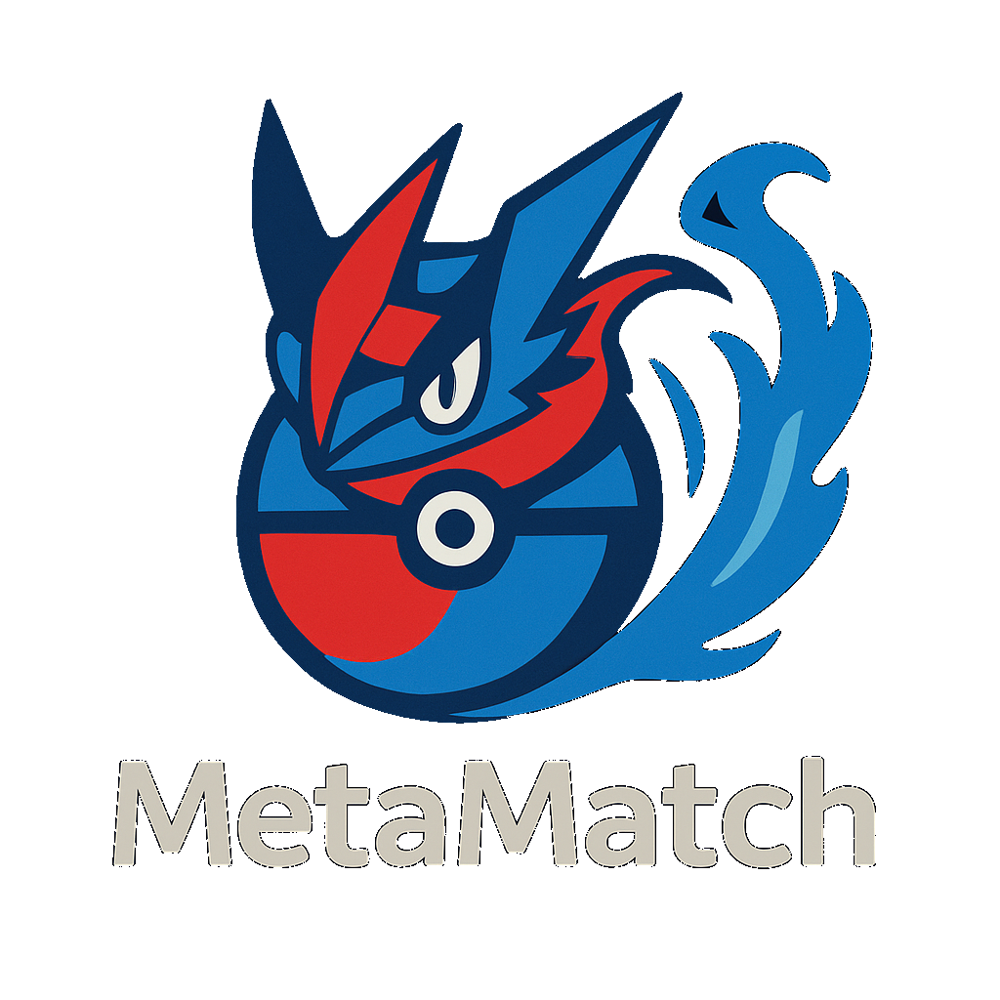
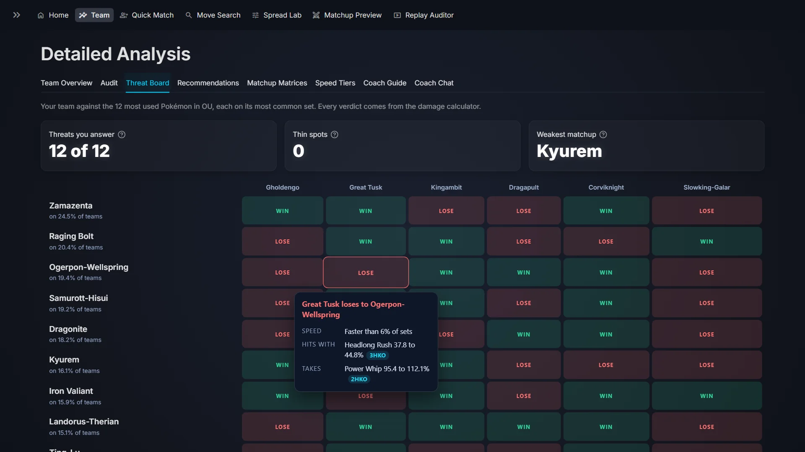
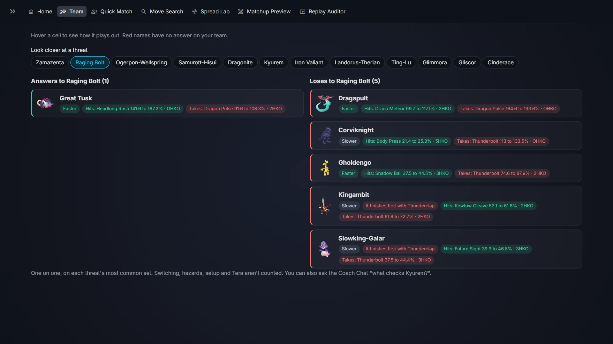
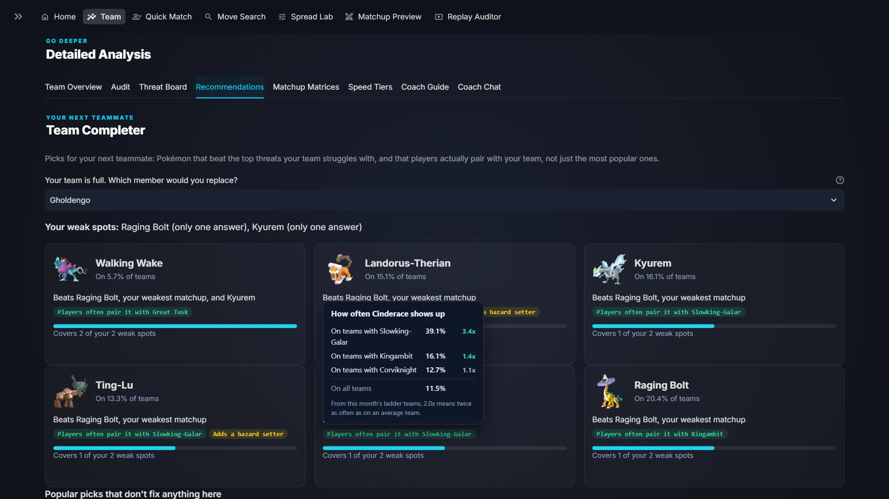
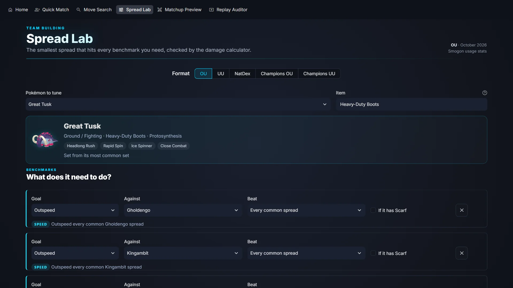
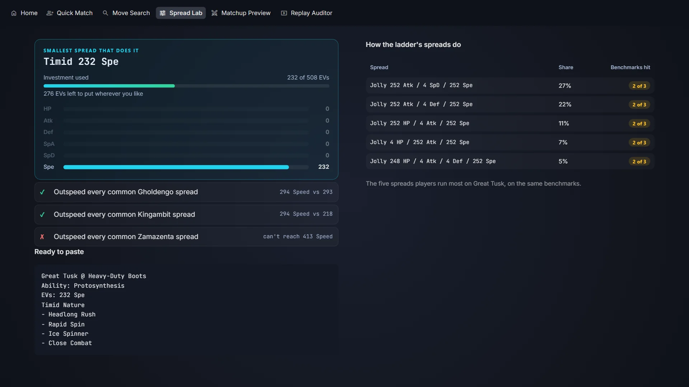
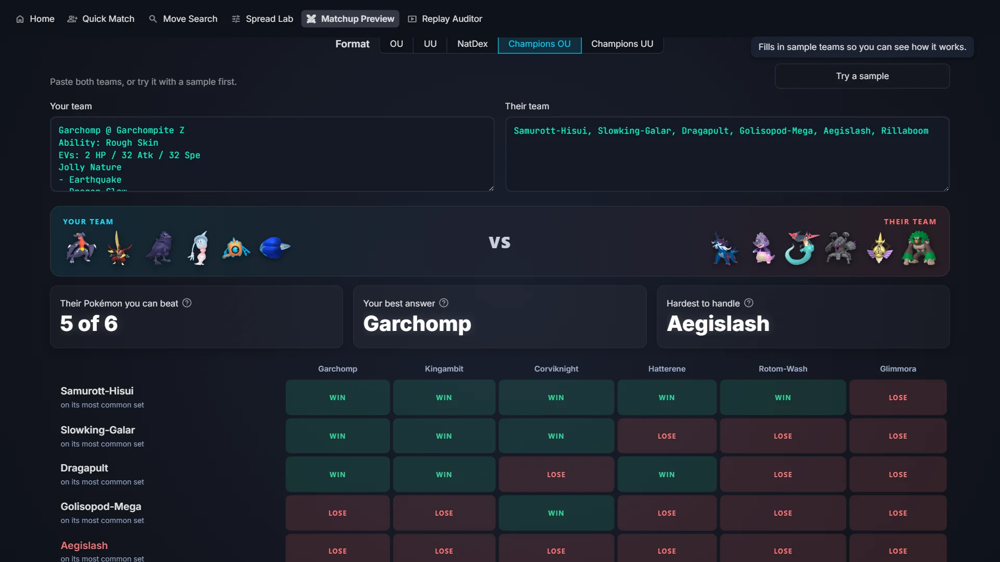
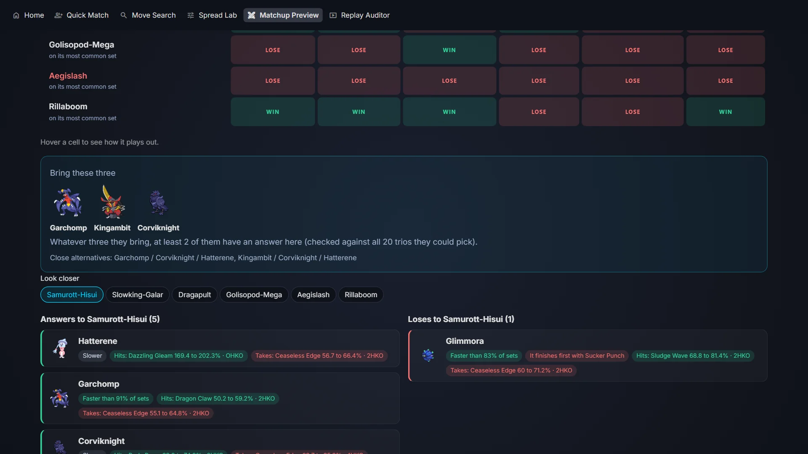

# MetaMatch: The Visual Tour

Everything MetaMatch does, without installing anything. Every screen is the real app running locally: real ladder data, real engine verdicts and real answers from a 3B model on a laptop GPU. Nothing is mocked.

[Main README](../README.md) · [Home](#home-and-metaflash) · [Dashboard](#the-team-dashboard) · [Coach chat](#the-coaching-staff) · [Team building](#team-building-tools) · [Tools](#tools) · [Everyday use](#built-to-be-used)

*One click on "Try a sample team": parsing, roles, type math, threats and audit land in about a second.*

---

## Home and MetaFlash

### Home

A paste box for a Showdown export or pokepast.es link, and a format picker that drives the whole app.

### MetaFlash

Six months of Smogon usage stats turned into a front page that rewrites itself every month: the story of the month with a six month chart, and the top 10 with rank changes.

### Story cards

The #1, the biggest risers and fallers, newcomers to the top 30 and the fastest common threat. Every headline is chosen by rules from the data, not written by a model.

### Partner cards

Hover any partner to see its types, ladder rank, usage and usual item.

### Every format

Switch the format and the page rebuilds for that ladder, here Pokémon Champions OU with Mega Evolution.

---

## The Team Dashboard

### Squad

Every member parsed, typed, statted and given competitive roles.

### Team Overview

Which types you hit and which ones hit you, counted per member.

### Audit and Team Check

Legality in plain English, a one click conversion between SV EVs and Champions stat points, a team report to download, and checks for item and ability synergy, missing roles and coverage holes.

### Threat Board

Your team against the format's 12 most used Pokémon, one matchup at a time, every verdict worked out by the damage calculator.

Hover any cell to see how the matchup plays out: who moves first, the best hit each way and how many hits each side needs.

Pick a threat to see exactly who answers it and who loses to it.

### Team Completer

The next teammate, picked by which of your weak spots it beats and how often players really pair it with your team, not by popularity. Across 882 tests on real ladder teams, its first pick fixes 82% of a team's weak spots.

Hover a pairing to see the ladder numbers behind it.

### Matchup Matrices

The full type chart for your six, on defence and on offence.

### Speed Tiers

Your true Speed, with items and IVs, against every spread the format's top Pokémon really run, with Choice Scarf sets marked and a slider to test more Speed.

---

## The Coaching Staff

Questions are planned by code first. Facts (speed, damage, KOs, types, usage) are computed by the engine and stated before the model says a word; the model only explains, and a verifier rejects any explanation that contradicts the engine.

### Clemont, mechanics

The verdict comes from the engine, the explanation from the model, checked against it.

### Professor Oak, strategy

One on one engine verdicts open the answer, then verified advice, with the Smogon references he read listed underneath.

### Brock, building

Usage numbers straight from this month's ladder stats.

### Asking when unsure

When a question is ambiguous, it asks instead of answering a different question.

---

## Team Building Tools

### Spread Lab

Pick what your Pokémon needs to do: outspeed a threat, OHKO or 2HKO a target, survive a hit. It finds the smallest spread that does all of it.

Every benchmark is rechecked with the damage calculator, and compared with the spreads players run most.

### Matchup Preview

Paste the team you're about to face, even just the six names from team preview, and see every matchup.

In Pokémon Champions it also picks the three to bring, checked against every three they could bring.

---

## Tools

### Quick Match

No team yet? Pick a core and get the partners players actually build with it in your format.

### Move Search

Every set that runs a combination of moves, from the Smogon Strategy Dex and ladder usage.

### Replay Auditor

A post mortem of any Showdown replay: the result, team health turn by turn and the cause of every faint.

Mistakes and notes dated to their turn, and every set the opponent revealed.

---

## Built to Be Used

### It remembers

Recent teams sit in the sidebar, one click from reopening, and saved teams show every set on hover. Every team has its own link, so refresh, bookmarks, Back and a second tab all keep your dashboard.

### It works offline

With the model server off, every analysis tab still runs and the coach answers with the engine's facts.

### It works on a phone

