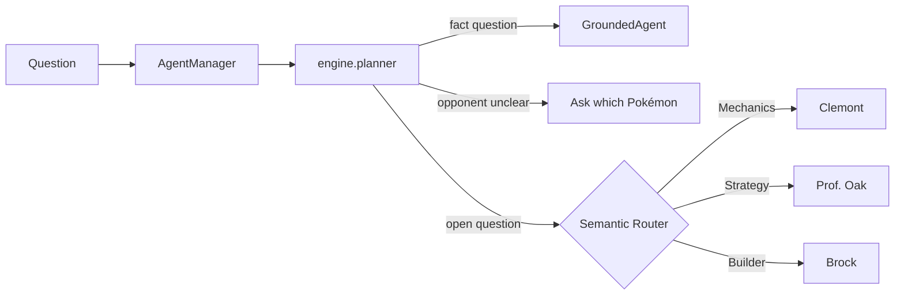

# Agents

Chat questions enter through `AgentManager`. Fact questions the engine can solve go down the grounded path; everything else is routed to one of three agents.



## Grounded path (`grounded.py`)

The planner and solvers in `metamatch.engine` produce a `Verdict` (answer, statement, facts). `GroundedAgent` then:

1. Shows the verdict statement, filled from a template so it is always the solver's answer.
2. Asks the LLM for a short explanation of the facts.
3. Runs `verify()`: every number must appear in the facts, and the text must not contradict the speed, type or KO verdict.
4. Retries once with the verifier's feedback, then falls back to listing the facts.

## The agents

| Agent | Persona | Handles | Temperature | File |
| :--- | :--- | :--- | :--- | :--- |
| Tactician | Clemont | Mechanics questions the planner could not resolve | `0.0` | `tactician.py` |
| Coach | Prof. Oak | Strategy and win conditions, with retrieval from ChromaDB | `0.4` | `coach.py` |
| Auditor | Brock | Sets and items checked against ladder usage | `0.2` | `auditor.py` |

Oak and Brock also receive likely set cards for any opponent named in the question, plus the last six chat turns.

## Routing (`router.py`)

The router embeds the question with `all-MiniLM-L6-v2` and compares it to anchor phrases for each agent. Damage, KO, speed and immunity wording goes to Clemont directly. Below a 0.45 similarity score the question falls back to Oak.

## Usage

```python
from metamatch.agents import AgentManager

manager = AgentManager()
for chunk in manager.get_response(query="Does my Dragapult outspeed Iron Valiant?",
                                  team_context=team, team_weakness=weakness, history=[]):
    print(chunk, end="")
```

`get_response` always yields plain text chunks.
